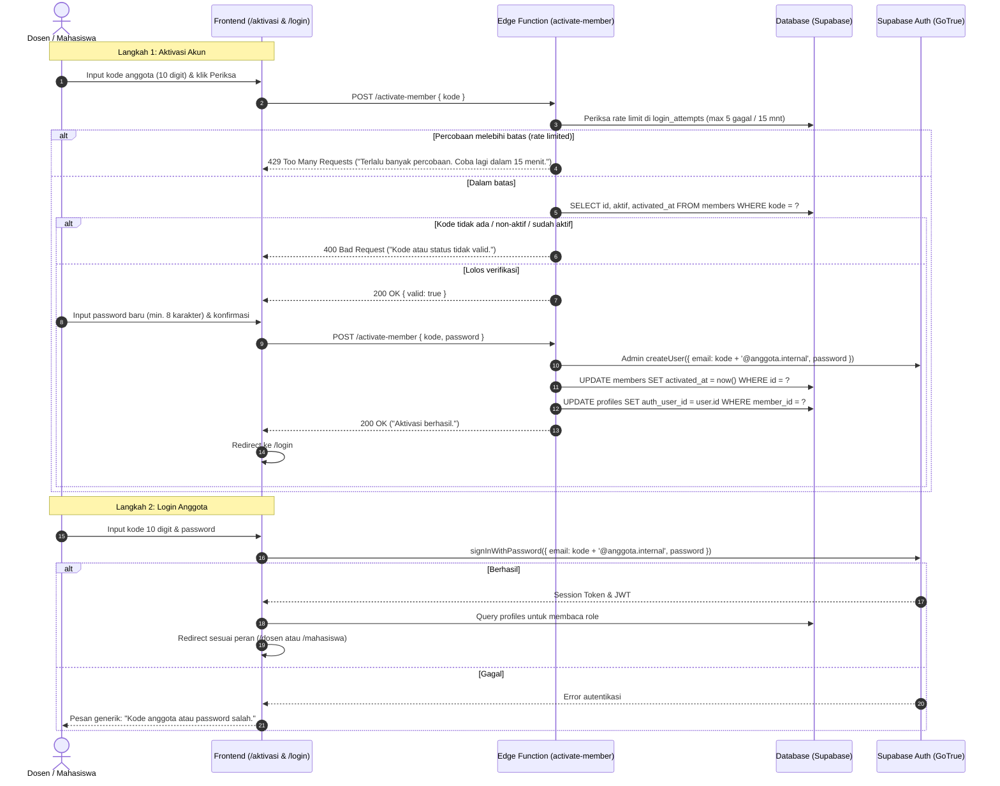
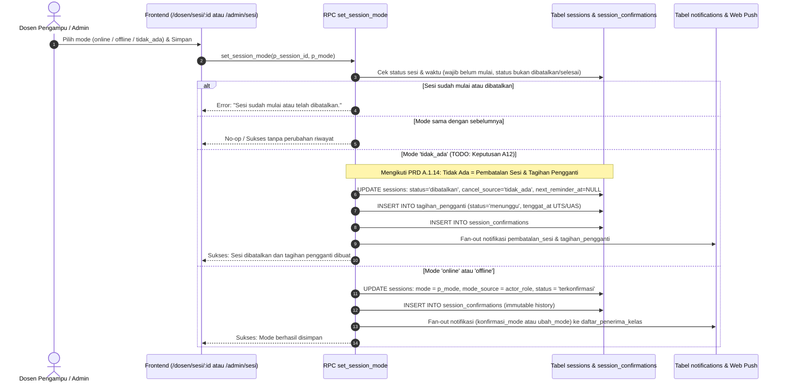
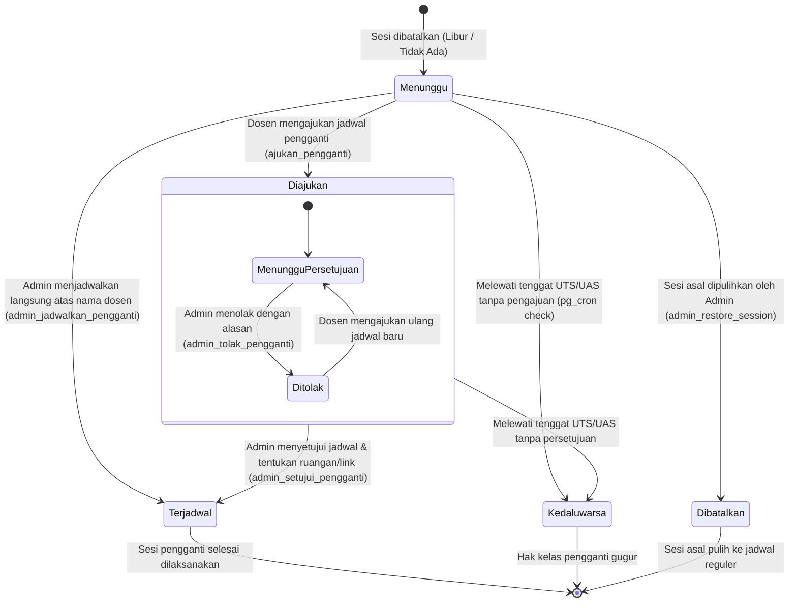
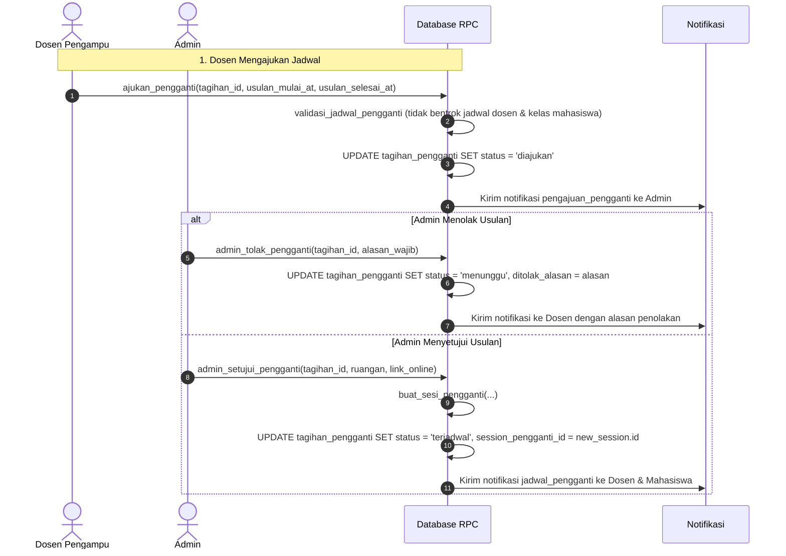
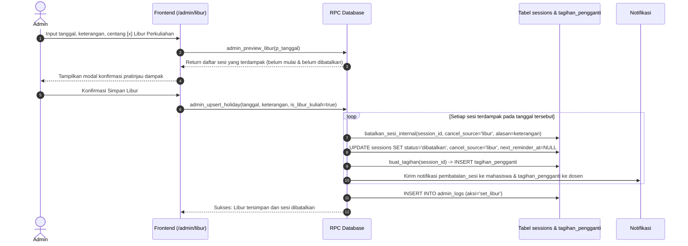
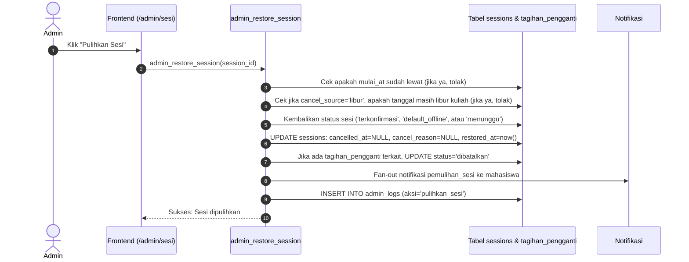
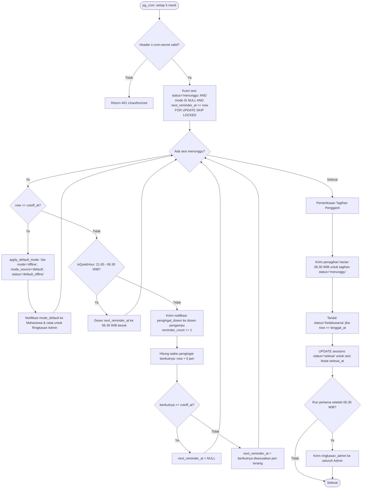

# Diagram Alur Sistem (FLOW) - SysPro v2.2

Dokumen ini memvisualisasikan seluruh alur bisnis utama sistem SysPro v2.2 menggunakan diagram Mermaid, sesuai dengan spesifikasi di `docs/PRD.md` dan `AGENTS.md`.

---

## 1. Alur Autentikasi dan Aktivasi Anggota

Anggota (Dosen dan Mahasiswa) diimpor oleh Admin terlebih dahulu via CSV. Akun autentikasi diaktifkan secara mandiri oleh anggota melalui halaman `/aktivasi`.

---

## 2. Alur Konfirmasi dan Perubahan Mode Kuliah

Dosen pengampu kelas atau Admin dapat mengonfirmasi atau mengubah mode sesi kuliah (Online, Offline, Tidak Ada) sebelum waktu mulai (`mulai_at`).

---

## 3. Alur Siklus Tagihan Kelas Pengganti (Replacement Classes)

Tagihan kelas pengganti tercipta otomatis saat sesi dibatalkan karena libur perkuliahan (`is_libur_kuliah = true`) atau saat dosen/admin memilih mode "Tidak Ada".

### Detail Interaksi Pengajuan dan Persetujuan Pengganti

---

## 4. Alur Manajemen Libur dan Dampak Perkuliahan

Hanya hari libur dengan centang **Libur Perkuliahan** (`is_libur_kuliah = true`) yang membatalkan sesi dan menagih sesi pengganti.

---

## 5. Alur Pemulihan Sesi Kuliah (`admin_restore_session`)

Admin dapat memulihkan sesi yang sebelumnya dibatalkan, dengan syarat tanggal sesi tidak sedang dalam status libur perkuliahan dan sesi belum lewat waktu mulai.

---

## 6. Alur Cron Scheduler Pengingat dan Default Otomatis (`run-reminders`)

pg_cron menjalankan Edge Function `run-reminders` setiap 5 menit.

