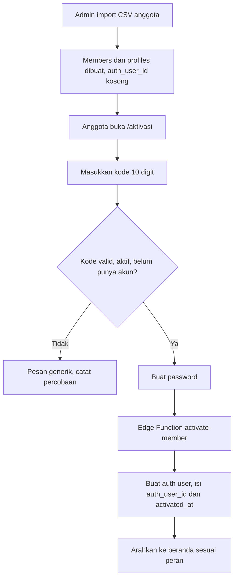
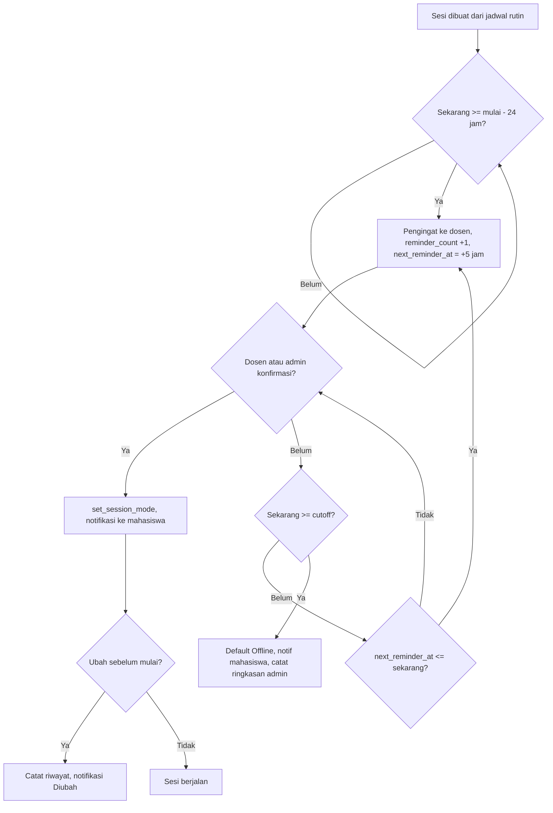
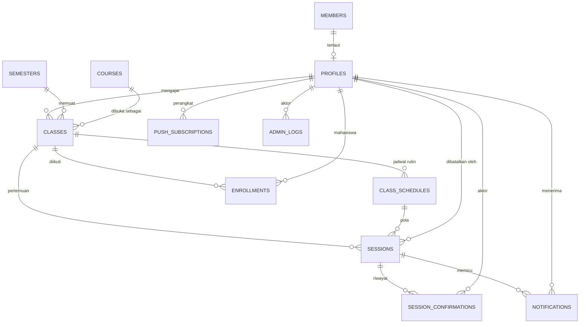

# PRD: SysPro (v2.2)

**Sistem Informasi Jadwal Kuliah dan Konfirmasi Mode Kelas**
Program Studi Produksi Media | Versi 2.2 | 14 Oktober 2026
Dokumen acuan utama. Jika ada konflik dengan `AGENTS.md`, dokumen ini yang menang sampai ada keputusan tertulis.

---

## Cara Membaca Dokumen Ini

Dokumen ini terdiri dari dua bagian:

1. **Bagian A: Perubahan v2.2 (berlaku).** Mengganti bagian yang sama di Bagian B. Bagian ini memuat angkatan dan kelompok, jumlah pertemuan N, generator tepat N, salin semester, pindah kelompok, DDL dan fungsi yang diperbarui, serta keputusan terbuka 14 sampai 17.
2. **Bagian B: PRD v2.1 (dasar).** Seluruh isi PRD v2.1. Bagian yang tercantum di Bagian A sudah tidak berlaku. Jika ada pertentangan, Bagian A yang menang.

Setelah keputusan 14 sampai 17 dijawab, Bagian A dan B akan digabung menjadi satu alur utuh pada revisi berikutnya.

---

# BAGIAN A: PERUBAHAN v2.2 (BERLAKU)


---

## Peta Perubahan

| Bagian v2.1 | Aksi |
|---|---|
| Header dan changelog | Ganti versi ke 2.2 |
| 2.2 Cakupan v1 | Ganti |
| 4.1 Autentikasi (poin import CSV) | Ganti |
| 4.4 Admin | Ganti |
| 4.6 Kelompok Mahasiswa | Tambah (baru) |
| 5.6 dan 5.7 Notifikasi | Ganti kolom `Isi` |
| 5.14 Angkatan dan Kelompok | Tambah (baru) |
| 5.15 Jumlah Pertemuan | Tambah (baru) |
| 5.16 Aturan Generator Sesi | Tambah (baru) |
| 6.7 Alur mahasiswa | Tambah |
| 8.1 Ringkasan tabel | Ganti |
| 8.3 DDL | Ganti tabel `profiles`, `classes`, `sessions`. Tambah `cohorts`, `student_groups`. Hapus `enrollments` |
| 8.4 Helper | Tambah fungsi baru |
| 8.6 Generator | Ganti seluruhnya |
| 8.6a Salin semester dan pindah kelompok | Tambah (baru) |
| 8.7 s/d 8.10 Pola fan-out | Ganti dengan aturan di 8.9 |
| 8.12 Seed | Ganti |
| 9.3 dan 9.4 | Ganti |
| 10.1 Endpoint | Tambah RPC baru, ganti spesifikasi import |
| 11.4 Push | Tambah batch |
| 12.3 Kartu sesi | Tambah |
| 13 Kapasitas | Ganti baris |
| 15.2 pgTAP | Tambah kasus |
| 17 Rencana | Ganti fase 3 dan 4 |
| 18 Risiko | Tambah dua baris |
| 19.2 Terbuka | Tambah nomor 14 sampai 17 |

---

## Changelog

| Versi | Tanggal | Perubahan |
|---|---|---|
| 2.2 | 14 Okt 2026 | Angkatan dan kelompok mahasiswa (A, B, C). Jumlah pertemuan N per kelas. Generator tepat N. Enrollment dihapus dari v1, diganti join `profiles.group_id`. |

---

## 2.2 Cakupan v1 (ganti)

- Autentikasi anggota dengan kode 10 digit dan password. Admin dengan email dan password.
- Manajemen semester, angkatan, kelompok mahasiswa (kelas A, B, C per angkatan), mata kuliah, kelas per semester, jadwal rutin, anggota, dan tanggal libur.
- Pembentukan sesi otomatis: tepat N pertemuan per kelas, dengan N ditentukan admin per kelas.
- Salin konfigurasi dari semester sebelumnya.
- Konfirmasi dan perubahan mode oleh dosen atau admin.
- Pengingat berkala ke dosen, default mode, dan ringkasan ke admin.
- Pembatalan dan pemulihan sesi oleh admin, termasuk pembatalan otomatis karena libur perkuliahan.
- Notifikasi in-app dan Web Push.
- Jadwal mahasiswa (minggu dan bulan) dengan dukungan offline.
- PWA: installable, offline shell.

---

## 4.1 Autentikasi (ganti poin import pada bagian Anggota)

- Admin mengimpor anggota lewat CSV dengan kolom: `kode, nama, peran, nim_nidn, angkatan, kelas`. Untuk mahasiswa, `angkatan` dan `kelas` wajib. Untuk dosen, kedua kolom itu kosong. Lihat 10.2.

---

## 4.4 Admin (ganti seluruh bagian)

- **Ringkasan (`/admin`):** sesi hari ini, sesi menunggu, sesi default, sesi dibatalkan, dan peringatan kekurangan pertemuan.
- **Semester (`/admin/semester`):** CRUD. Tombol "Salin dari semester sebelumnya" tampil di halaman ini.
- **Angkatan dan kelompok (`/admin/angkatan`):** CRUD angkatan (misalnya 2025) dan kelompok di dalamnya (A, B, C). Halaman ini harus disiapkan sebelum import anggota.
- **Mata kuliah (`/admin/mata-kuliah`):** CRUD.
- **Kelas (`/admin/kelas`):** dibuat per semester. Admin memilih mata kuliah, satu atau beberapa kelompok, dosen pengampu, jadwal rutin, dan jumlah pertemuan N.
- **Anggota (`/admin/anggota`):** import CSV, filter per angkatan dan kelompok, statistik jumlah per kelompok, pindah kelompok (alasan wajib), nonaktifkan, reset akses.
- **Libur (`/admin/libur`):** tanggal merah dan libur institusi, dengan flag libur perkuliahan (lihat 5.9).
- **Sesi (`/admin/sesi`):** filter per status, konfirmasi atau ubah mode atas nama dosen, batalkan sesi, pulihkan sesi.
- **Log (`/admin/log`):** riwayat perubahan mode, pembatalan, pemulihan, pindah kelompok, dan aksi admin lain.

---

## 4.6 Kelompok Mahasiswa (baru)

- Satu mahasiswa berada di tepat satu kelompok (`profiles.group_id`).
- Mahasiswa melihat dan menerima notifikasi hanya untuk kelas dengan `classes.group_id` yang sama dengan kelompoknya.
- Dosen yang mengajar satu mata kuliah untuk beberapa kelompok melihat satu kartu per kelompok.
- Pindah kelompok hanya oleh admin lewat RPC `admin_pindah_kelompok`. Efeknya berlaku mulai saat itu (lihat keputusan terbuka 17).

---

## 5.6 dan 5.7 Notifikasi (ganti kolom `Isi`)

Label kelompok `X` berbentuk `{tahun} {kelompok}`, contoh "2025 A". Label ini diambil dari fungsi `nama_kelompok(class_id)`.

**Mahasiswa:**

| Kejadian | Isi |
|---|---|
| Konfirmasi pertama (`konfirmasi_mode`) | `{Mata kuliah}, Kelas {X}, pertemuan {n} dari {N}, {hari, DD Bln YYYY, HH.MM}. Mode: {mode}.` |
| Mode diubah (`ubah_mode`) | `Diubah: {Mata kuliah}, Kelas {X}, pertemuan {n} dari {N}, {jam}. Mode sekarang: {mode}.` |
| Default berlaku (`mode_default`) | `{Mata kuliah}, Kelas {X}, pertemuan {n} dari {N}, {jam}. Mode default: Offline.` |
| Pembatalan (`pembatalan_sesi`) | `Dibatalkan: {Mata kuliah}, Kelas {X}, pertemuan {n} dari {N}, {tanggal, jam}.` Jika ada keterangan, tambahkan ` Keterangan: {teks}.` |
| Pemulihan (`pemulihan_sesi`) | `Dipulihkan: {Mata kuliah}, Kelas {X}, pertemuan {n} dari {N}, {tanggal, jam}. Jadwal kembali aktif.` |

**Dosen:**

| Kejadian | Isi |
|---|---|
| Pengingat (`pengingat_dosen`) | `Konfirmasi kuliah: {Mata kuliah}, Kelas {X}, pertemuan {n} dari {N}, {jam mulai}–{jam selesai}.` |

---

## 5.14 Angkatan dan Kelompok (baru)

- Angkatan bersifat persisten lintas semester. Kelompok terikat pada angkatan.
- Import CSV tidak membuat angkatan atau kelompok. Baris yang merujuk kelompok yang belum ada ditolak dengan pesan jelas.
- Kelas (`classes`) adalah satu mata kuliah, dalam satu semester, untuk satu kelompok.
- Mahasiswa wajib punya kelompok. Constraint pada `profiles` mencegah mahasiswa tanpa `group_id`.

---

## 5.15 Jumlah Pertemuan (baru)

- Setiap kelas punya `jumlah_pertemuan` (N), default 16. Admin dapat mengubahnya per kelas.
- Nilai N tidak boleh ditulis sebagai konstanta di kode atau migrasi. Satu-satunya pengecualian adalah default kolom.
- Setiap sesi punya `pertemuan_ke` (1 sampai N). Nomor ini tampil di UI dan notifikasi.
- Satu kelas dengan dua jadwal rutin per minggu mendapat N pertemuan total, bukan N per jadwal.
- Kolom `jenis` (`reguler`, `uts`, `uas`, `pengganti`) menyimpan tipe sesi. Generator reguler hanya membuat `jenis = 'reguler'`. Apakah UTS dan UAS masuk hitungan N belum diputuskan (keputusan 15).

---

## 5.16 Aturan Generator Sesi (baru)

- Generator hanya dapat dijalankan sebelum `tanggal_mulai` semester.
- Generator hanya dapat dijalankan sekali per semester. Jika sesi sudah ada, admin menggunakan fitur edit, bukan generate ulang.
- Generator membentuk tepat N pertemuan per kelas. Tanggal yang cocok dengan jadwal rutin diambil berurutan, dengan melewati tanggal `is_libur_kuliah = true`.
- Jika libur memotong jadwal, pertemuan yang hilang digeser ke tanggal berikutnya dalam ruang cadangan 60 hari setelah `tanggal_selesai`. **Keputusan 14 belum final.** Versi ini memakai opsi (a) sebagai sementara.
- Jika setelah ruang cadangan jumlah pertemuan belum tercapai, generator tetap membuat yang tersedia dan mencatat kekurangannya di `admin_logs` (`detail.kurang`). Admin melihat peringatan di `/admin/sesi`.

---

## 6.7 Alur Mahasiswa (tambahkan)

1. Saat dosen mengonfirmasi, hanya mahasiswa kelompok kelas tersebut yang menerima notifikasi.
2. Notifikasi menampilkan pertemuan ke-n dari N.

---

## 8.1 Ringkasan Tabel (ganti)

| Tabel | Fungsi | Diakses oleh |
|---|---|---|
| `members` | Daftar resmi anggota dari admin | Admin |
| `profiles` | Profil pengguna, terhubung ke `auth.users`, punya `group_id` untuk mahasiswa | Pemilik, admin |
| `cohorts` | Angkatan | Semua login (baca), admin (tulis) |
| `student_groups` | Kelompok dalam angkatan (A, B, C) | Semua login (baca), admin (tulis) |
| `semesters` | Periode semester | Semua login (baca), admin (tulis) |
| `courses` | Mata kuliah | Semua login (baca), admin (tulis) |
| `classes` | Mata kuliah × semester × kelompok, dengan N pertemuan | Semua login (baca), admin (tulis) |
| `class_schedules` | Jadwal rutin | Semua login (baca), admin (tulis) |
| `holidays` | Tanggal merah dan libur, flag libur perkuliahan | Semua login (baca), admin lewat RPC |
| `sessions` | Pertemuan konkret, dengan `pertemuan_ke` | Sesuai RLS (bagian 9) |
| `session_confirmations` | Riwayat mode, append-only | Sesuai RLS |
| `notifications` | Inbox per pengguna | Pemilik |
| `push_subscriptions` | Perangkat untuk Web Push | Pemilik |
| `admin_logs` | Log aksi admin | Admin |
| `login_attempts` | Pembatasan percobaan | Service role saja |

Tabel `enrollments` dihapus dari v1.

---

## 8.3 DDL (ganti tabel berikut)

Sistem belum berisi data produksi, sehingga DDL ini menggantikan definisi lama secara langsung. Jika database sudah berisi data, buat migrasi `alter` dari perbedaan ini.

```sql
-- ANGKATAN
create table public.cohorts (
  id          uuid primary key default gen_random_uuid(),
  tahun       smallint not null unique check (tahun between 2000 and 2100),
  nama        text not null,                       -- "Angkatan 2025"
  aktif       boolean not null default true,
  created_at  timestamptz not null default now()
);

-- KELOMPOK DALAM ANGKATAN (A, B, C, ...)
create table public.student_groups (
  id          uuid primary key default gen_random_uuid(),
  cohort_id   uuid not null references public.cohorts(id) on delete restrict,
  nama        text not null,                       -- "A", "B", "C"
  created_at  timestamptz not null default now(),
  unique (cohort_id, nama)
);

-- PROFILES (menggantikan definisi lama)
create table public.profiles (
  id           uuid primary key default gen_random_uuid(),
  auth_user_id uuid unique references auth.users(id) on delete set null,
  member_id    uuid unique references public.members(id) on delete restrict,
  role         text not null check (role in ('admin', 'dosen', 'mahasiswa')),
  nama         text not null,
  group_id     uuid references public.student_groups(id) on delete restrict,
  created_at   timestamptz not null default now(),
  constraint profiles_member_admin check (
    (role = 'admin' and member_id is null) or
    (role <> 'admin' and member_id is not null)
  ),
  constraint profiles_group_mahasiswa check (
    (role = 'mahasiswa' and group_id is not null)
    or (role <> 'mahasiswa' and group_id is null)
  )
);
create index profiles_group_idx on public.profiles (group_id);

-- CLASSES (satu baris = mata kuliah x semester x kelompok)
create table public.classes (
  id               uuid primary key default gen_random_uuid(),
  course_id        uuid not null references public.courses(id) on delete restrict,
  semester_id      uuid not null references public.semesters(id) on delete cascade,
  group_id         uuid not null references public.student_groups(id) on delete restrict,
  dosen_id         uuid not null references public.profiles(id) on delete restrict,
  jumlah_pertemuan smallint not null default 16 check (jumlah_pertemuan between 1 and 30),
  created_at       timestamptz not null default now(),
  unique (course_id, semester_id, group_id)
);
create index classes_dosen_idx    on public.classes (dosen_id);
create index classes_semester_idx on public.classes (semester_id, group_id);

-- SESSIONS (menggantikan definisi lama)
create table public.sessions (
  id               uuid primary key default gen_random_uuid(),
  class_id         uuid not null references public.classes(id) on delete cascade,
  schedule_id      uuid not null references public.class_schedules(id) on delete cascade,
  pertemuan_ke     smallint not null check (pertemuan_ke >= 1),
  jenis            text not null default 'reguler'
                     check (jenis in ('reguler', 'uts', 'uas', 'pengganti')),
  tanggal          date not null,
  mulai_at         timestamptz not null,
  selesai_at       timestamptz not null,
  mode             text check (mode in ('online', 'offline', 'tidak_ada')),
  mode_source      text check (mode_source in ('dosen', 'admin', 'default')),
  status           text not null default 'menunggu' check (
                     status in ('menunggu', 'terkonfirmasi', 'default_offline', 'dibatalkan', 'selesai')),
  cutoff_at        timestamptz not null,
  next_reminder_at timestamptz,
  reminder_count   int not null default 0,
  escalated_at     timestamptz,
  cancelled_at     timestamptz,
  cancelled_by     uuid references public.profiles(id) on delete set null,
  cancel_source    text check (cancel_source in ('admin', 'libur')),
  cancel_reason    text,
  restored_at      timestamptz,
  created_at       timestamptz not null default now(),
  updated_at       timestamptz not null default now(),
  unique (class_id, pertemuan_ke),
  check (selesai_at > mulai_at),
  check (cutoff_at = mulai_at - interval '1 hour'),
  check (mode_source is null or mode is not null),
  check ((status = 'dibatalkan') = (cancelled_at is not null)),
  check (cancel_source is null or cancelled_at is not null)
);
create index sessions_cron_idx    on public.sessions (next_reminder_at)
  where status = 'menunggu' and mode is null;
create index sessions_mulai_idx   on public.sessions (mulai_at);
create index sessions_class_idx   on public.sessions (class_id);
create index sessions_tanggal_idx on public.sessions (tanggal);

-- ENROLLMENTS: DIHAPUS dari v1.
```

Tabel lain tidak berubah: `members`, `semesters`, `courses`, `class_schedules`, `holidays`, `session_confirmations`, `notifications`, `push_subscriptions`, `admin_logs`, `login_attempts`.

---

## 8.4 Fungsi Helper (tambahkan)

Sumber tunggal untuk penerima kelas. Semua fan-out notifikasi dan RLS memakai fungsi ini.

```sql
-- Mahasiswa yang berhak atas sebuah kelas, berdasarkan kelompok
create or replace function public.daftar_penerima_kelas(p_class_id uuid)
returns setof uuid
language sql stable security definer set search_path = public as $$
  select p.id
  from public.classes c
  join public.profiles p on p.group_id = c.group_id and p.role = 'mahasiswa'
  where c.id = p_class_id
$$;

create or replace function public.mahasiswa_ikut_kelas(p_class_id uuid)
returns boolean
language sql stable security definer set search_path = public as $$
  select exists (
    select 1 from public.daftar_penerima_kelas(p_class_id) id
    where id = public.app_profile_id()
  )
$$;

-- Label kelompok untuk notifikasi, contoh: "2025 A"
create or replace function public.nama_kelompok(p_class_id uuid)
returns text
language sql stable security definer set search_path = public as $$
  select coh.tahun::text || ' ' || sg.nama
  from public.classes c
  join public.student_groups sg on sg.id = c.group_id
  join public.cohorts coh on coh.id = sg.cohort_id
  where c.id = p_class_id
$$;

revoke all on function public.daftar_penerima_kelas(uuid) from public, anon, authenticated;
revoke all on function public.mahasiswa_ikut_kelas(uuid)  from public, anon;
revoke all on function public.nama_kelompok(uuid)         from public, anon;
grant execute on function public.mahasiswa_ikut_kelas(uuid) to authenticated;
```

---

## 8.6 Generator Sesi (ganti seluruh bagian)

Versi ini memakai opsi (a) untuk libur yang memotong jadwal. Ubah jika keputusan 14 sudah dijawab.

```sql
create or replace function public.generate_sessions(p_semester_id uuid)
returns int
language plpgsql security definer set search_path = public as $$
declare
  v_sem    public.semesters%rowtype;
  v_n      int;
  v_kurang jsonb;
begin
  if public.app_role() is distinct from 'admin' then
    raise exception 'Tidak diizinkan';
  end if;

  select * into v_sem from public.semesters where id = p_semester_id;
  if not found then
    raise exception 'Semester tidak ditemukan';
  end if;
  if v_sem.tanggal_mulai <= (now() at time zone 'Asia/Jakarta')::date then
    raise exception 'Jadwal hanya bisa dibuat sebelum semester dimulai';
  end if;
  if exists (select 1 from public.sessions s
             join public.classes c on c.id = s.class_id
             where c.semester_id = p_semester_id) then
    raise exception 'Jadwal semester ini sudah dibuat';
  end if;

  with kandidat as (
    select
      cl.id               as class_id,
      cs.id               as schedule_id,
      cl.jumlah_pertemuan as n,
      d::date             as tanggal,
      cs.jam_mulai,
      cs.jam_selesai,
      row_number() over (partition by cl.id order by d::date, cs.jam_mulai) as rn
    from public.classes cl
    join public.class_schedules cs on cs.class_id = cl.id
    cross join generate_series(
      v_sem.tanggal_mulai,
      v_sem.tanggal_selesai + interval '60 day',
      interval '1 day'
    ) d
    where cl.semester_id = p_semester_id
      and extract(dow from d)::smallint = cs.hari
      and not exists (
        select 1 from public.holidays h
        where h.tanggal = d::date and h.is_libur_kuliah
      )
  )
  insert into public.sessions
    (class_id, schedule_id, pertemuan_ke, tanggal, mulai_at, selesai_at, cutoff_at)
  select
    class_id, schedule_id, rn, tanggal,
    (tanggal + jam_mulai)   at time zone 'Asia/Jakarta',
    (tanggal + jam_selesai) at time zone 'Asia/Jakarta',
    (tanggal + jam_mulai)   at time zone 'Asia/Jakarta' - interval '1 hour'
  from kandidat
  where rn <= n;

  get diagnostics v_n = row_count;

  select coalesce(jsonb_agg(jsonb_build_object(
           'class_id', c.id,
           'kurang', c.jumlah_pertemuan - (select count(*) from public.sessions s where s.class_id = c.id)
         )), '[]'::jsonb)
    into v_kurang
  from public.classes c
  where c.semester_id = p_semester_id
    and (select count(*) from public.sessions s where s.class_id = c.id) < c.jumlah_pertemuan;

  insert into public.admin_logs (actor_id, aksi, target_tipe, target_id, detail)
  values (public.app_profile_id(), 'generate_sesi', 'semester', p_semester_id,
          jsonb_build_object('jumlah_baru', v_n, 'kurang', v_kurang));

  return v_n;
end $$;

revoke all on function public.generate_sessions(uuid) from public, anon;
grant execute on function public.generate_sessions(uuid) to authenticated;
```

---

## 8.6a Salin Semester dan Pindah Kelompok (baru)

```sql
create or replace function public.admin_copy_semester(p_from uuid, p_to uuid)
returns int language plpgsql security definer set search_path = public as $$
declare
  n int;
begin
  if public.app_role() is distinct from 'admin' then
    raise exception 'Tidak diizinkan';
  end if;
  if exists (select 1 from public.classes where semester_id = p_to) then
    raise exception 'Semester tujuan sudah punya kelas';
  end if;

  with kelas_baru as (
    insert into public.classes
      (course_id, semester_id, group_id, dosen_id, jumlah_pertemuan)
    select course_id, p_to, group_id, dosen_id, jumlah_pertemuan
    from public.classes where semester_id = p_from
    returning id, course_id, group_id
  )
  insert into public.class_schedules (class_id, hari, jam_mulai, jam_selesai)
  select kb.id, cs.hari, cs.jam_mulai, cs.jam_selesai
  from kelas_baru kb
  join public.classes co on co.semester_id = p_from
                        and co.course_id = kb.course_id
                        and co.group_id = kb.group_id
  join public.class_schedules cs on cs.class_id = co.id;

  get diagnostics n = row_count;

  insert into public.admin_logs (actor_id, aksi, target_tipe, detail)
  values (public.app_profile_id(), 'salin_semester', 'semester',
          jsonb_build_object('dari', p_from, 'ke', p_to, 'jadwal_disalin', n));

  return n;
end $$;

create or replace function public.admin_pindah_kelompok(
  p_profile_id uuid, p_group_id uuid, p_alasan text
) returns void language plpgsql security definer set search_path = public as $$
declare
  v_lama   uuid;
  v_alasan text := nullif(trim(p_alasan), '');
begin
  if public.app_role() is distinct from 'admin' then
    raise exception 'Tidak diizinkan';
  end if;
  if v_alasan is null then
    raise exception 'Alasan wajib diisi';
  end if;

  select group_id into v_lama
    from public.profiles
   where id = p_profile_id and role = 'mahasiswa'
   for update;
  if not found then
    raise exception 'Mahasiswa tidak ditemukan';
  end if;

  update public.profiles set group_id = p_group_id where id = p_profile_id;

  insert into public.admin_logs (actor_id, aksi, target_tipe, target_id, detail)
  values (public.app_profile_id(), 'pindah_kelompok', 'profile', p_profile_id,
          jsonb_build_object('dari', v_lama, 'ke', p_group_id, 'alasan', v_alasan));
end $$;

revoke all on function public.admin_copy_semester(uuid, uuid) from public, anon;
revoke all on function public.admin_pindah_kelompok(uuid, uuid, text) from public, anon;
grant execute on function public.admin_copy_semester(uuid, uuid) to authenticated;
grant execute on function public.admin_pindah_kelompok(uuid, uuid, text) to authenticated;
```

---

## 8.7 s/d 8.10 Pola Fan-Out (ganti dengan aturan ini)

Fungsi berikut harus mengganti `from public.enrollments e where e.class_id = X` menjadi `from public.daftar_penerima_kelas(X) p(mahasiswa_id)`:

- `set_session_mode`
- `batalkan_sesi_internal`
- `apply_default_mode`
- `admin_restore_session`

Contoh bagian notifikasi di `set_session_mode`:

```sql
insert into public.notifications (user_id, session_id, tipe, judul, isi, aksi_url)
select
  p.mahasiswa_id,
  p_session_id,
  v_tipe,
  case when v_tipe = 'ubah_mode' then 'Diubah' else 'Konfirmasi kuliah' end,
  case when v_tipe = 'ubah_mode' then 'Diubah: ' else '' end
    || v_mk || ', Kelas ' || public.nama_kelompok(v_sesi.class_id)
    || ', pertemuan ' || v_sesi.pertemuan_ke || ' dari '
    || (select jumlah_pertemuan from public.classes where id = v_sesi.class_id)
    || ', ' || public.format_tanggal_jam_id(v_sesi.mulai_at)
    || '. Mode' || case when v_tipe = 'ubah_mode' then ' sekarang' else '' end
    || ': ' || v_label || '.',
  '/mahasiswa/sesi/' || p_session_id
from public.daftar_penerima_kelas(v_sesi.class_id) p(mahasiswa_id);
```

Variabel `v_kelas` tidak lagi dipakai. Ambil label kelompok dari `nama_kelompok(class_id)`.

---

## 8.9 Penerima Notifikasi (baru)

| Fungsi | Penerima |
|---|---|
| `set_session_mode` | Mahasiswa kelompok kelas |
| `batalkan_sesi_internal` | Mahasiswa kelompok kelas |
| `apply_default_mode` | Mahasiswa kelompok kelas |
| `admin_restore_session` | Mahasiswa kelompok kelas |
| `run-reminders` | Dosen pengampu (`classes.dosen_id`) saja |

---

## 8.12 Seed Data (ganti)

- 1 angkatan (2025) dengan kelompok A, B, C.
- 1 semester aktif.
- 9 mata kuliah, 27 kelas (9 mata kuliah × 3 kelompok), dengan N = 16 sebagai nilai data uji.
- 150 mahasiswa dummy, dibagi rata ke tiga kelompok. Kode dummy diawali `9`.
- 2 dosen dummy.
- 2 tanggal libur: satu dengan flag, satu tanpa.
- 1 admin, dibuat lewat Dashboard lalu di-insert ke `profiles`.

---

## 9.3 Matriks Akses (ganti baris berikut; baris lain tetap)

| Tabel | SELECT | INSERT | UPDATE | DELETE |
|---|---|---|---|---|
| `cohorts`, `student_groups` | Semua login | Admin | Admin | Admin |
| `profiles` | Pemilik, admin | Service role | Pemilik (`nama`). Admin lewat `admin_pindah_kelompok` | Tidak ada |
| `classes`, `class_schedules` | Semua login | Admin | Admin | Admin |
| `sessions` | Admin, dosen pengampu, mahasiswa kelompok kelas | Via `generate_sessions` | Via fungsi resmi saja | Tidak ada |
| `session_confirmations` | Admin, dosen pengampu, mahasiswa kelompok kelas | Via fungsi | Tidak ada | Tidak ada |

Baris `enrollments` dihapus dari matriks.

---

## 9.4 Policy (ganti `sessions_select` dan `confirmations_select`, tambahkan yang baru)

```sql
create policy sessions_select on public.sessions for select using (
  public.app_role() = 'admin'
  or exists (
    select 1 from public.classes c
    where c.id = sessions.class_id and c.dosen_id = public.app_profile_id()
  )
  or public.mahasiswa_ikut_kelas(sessions.class_id)
);

create policy confirmations_select on public.session_confirmations for select using (
  exists (
    select 1 from public.sessions s
    where s.id = session_confirmations.session_id
      and (
        public.app_role() = 'admin'
        or exists (select 1 from public.classes c
                   where c.id = s.class_id and c.dosen_id = public.app_profile_id())
        or public.mahasiswa_ikut_kelas(s.class_id)
      )
  )
);

alter table public.cohorts        enable row level security;
alter table public.student_groups enable row level security;

create policy cohorts_select on public.cohorts for select using (auth.uid() is not null);
create policy cohorts_admin  on public.cohorts for all
  using (public.app_role() = 'admin') with check (public.app_role() = 'admin');

create policy student_groups_select on public.student_groups for select using (auth.uid() is not null);
create policy student_groups_admin  on public.student_groups for all
  using (public.app_role() = 'admin') with check (public.app_role() = 'admin');
```

Setiap tabel baru wajib `enable row level security`. Tabel `enrollments` sudah tidak ada.

---

## 10.1 Endpoint (tambahkan)

| Endpoint | Metode | Akses | Fungsi |
|---|---|---|---|
| `/rest/v1/rpc/admin_copy_semester` | POST | Admin | Salin kelas dan jadwal dari semester lain |
| `/rest/v1/rpc/admin_pindah_kelompok` | POST | Admin | Pindah mahasiswa ke kelompok lain (alasan wajib) |

Body contoh:
- `admin_copy_semester`: `{ "p_from": "uuid", "p_to": "uuid" }`
- `admin_pindah_kelompok`: `{ "p_profile_id": "uuid", "p_group_id": "uuid", "p_alasan": "teks" }`

---

## 10.2 Import Anggota (ganti spesifikasi)

Request body `admin-import-members`:

```json
{
  "rows": [
    { "kode": "9000000001", "nama": "Budi", "peran": "mahasiswa", "nim_nidn": "2501001", "angkatan": 2025, "kelas": "A" }
  ]
}
```

- Untuk mahasiswa, Edge Function mencari `cohorts.tahun` dan `student_groups.nama`. Jika tidak ditemukan, baris gagal dengan pesan "Angkatan atau kelas belum terdaftar".
- Untuk dosen, `angkatan` dan `kelas` harus kosong. Jika terisi, baris ditolak.
- Respons berisi jumlah berhasil dan daftar baris gagal beserta alasannya.

---

## 11.4 Pengiriman Push (tambahan)

- `send-push` mengirim dalam batch 50 subscription per panggilan.
- Kegagalan per endpoint dicatat per ID notifikasi, tanpa menghentikan batch.
- Fan-out satu kelas (sekitar 50 mahasiswa) dilakukan dalam satu transaksi fungsi resmi.

---

## 12.3 Kartu Sesi (tambahan)

- Setiap kartu menampilkan "Pertemuan {n} dari {N}".
- Dosen dengan beberapa kelompok untuk mata kuliah yang sama melihat satu kartu per kelompok, dengan label "Produksi Video Lanjut · 2025 A".

---

## 13 Kebutuhan Non-Fungsional (ganti baris Kapasitas)

| Aspek | Target |
|---|---|
| Kapasitas | Dirancang untuk 150 mahasiswa per angkatan, 3 kelompok per angkatan, dan beberapa angkatan aktif. Jumlah mata kuliah, kelompok, dan pertemuan tidak dikunci di kode. |

Estimasi per semester sebagai acuan:

| Item | Perhitungan | Jumlah |
|---|---|---|
| Kelas | 9 mata kuliah × 3 kelompok | 27 |
| Sesi | 27 kelas × 16 pertemuan | 432 |
| Notifikasi konfirmasi | 432 sesi × ~50 mahasiswa per kelompok | ~21.600 |
| Pengingat ke dosen | 432 sesi × ~5 pengingat | ~2.160 |

---

## 15.2 pgTAP (tambahkan)

| Kasus | Ekspektasi |
|---|---|
| Generator membuat tepat N sesi per kelas | Jumlah per kelas sama dengan N |
| `pertemuan_ke` berurutan 1..N tanpa celah | Benar |
| Libur dengan flag memotong jadwal | Pertemuan digeser, total tetap N (opsi 14a) |
| Kelas dengan dua jadwal rutin per minggu | Total N, bukan 2N |
| Generator dijalankan kedua kali | Error "sudah dibuat" |
| Generator dijalankan setelah semester dimulai | Error |
| Generator kekurangan pertemuan setelah ruang cadangan | Dibuat yang tersedia, `admin_logs.detail.kurang` terisi |
| Mahasiswa kelompok A tidak menerima notifikasi kelompok B | 0 notifikasi |
| Mahasiswa tanpa kelompok | Ditolak constraint |
| Admin pindah kelompok tanpa alasan | Error "Alasan wajib diisi" |
| Admin pindah kelompok | Akses dan notifikasi mengikuti kelompok baru, `admin_logs` tercatat |
| Mahasiswa kelompok A membaca sesi kelompok B | 0 baris |
| `admin_copy_semester` ke semester yang sudah punya kelas | Error |
| `admin_copy_semester` berhasil | Kelas dan jadwal tersalin, sesi tidak ikut |

---

## 17 Rencana Pengembangan (ganti fase 3 dan 4)

| Fase | Durasi | Output | Definisi selesai |
|---|---|---|---|
| 3. Data master | 1,5 minggu | CRUD semester, angkatan, kelompok, mata kuliah, kelas (multi-kelompok), jadwal, anggota, import CSV, salin semester, pindah kelompok | Admin bisa menyiapkan satu semester penuh dengan 3 kelompok |
| 4. Generator sesi | 4 hari | `generate_sessions` tepat N per kelas, ruang cadangan libur, pencatatan kekurangan | pgTAP generator lulus |

---

## 18 Risiko (tambahkan)

| Risiko | Dampak | Mitigasi |
|---|---|---|
| Kesalahan pembagian kelompok saat import | Mahasiswa menerima jadwal yang salah | Statistik per kelompok di `/admin/anggota`, pindah kelompok dengan alasan |
| Generator menghasilkan kurang dari N pertemuan | Jumlah pertemuan tidak sesuai aturan prodi | Ruang cadangan, pencatatan kekurangan, peringatan di `/admin/sesi` |

---

## 19.2 Masih Terbuka (tambahkan)

14. **Libur memotong jadwal:** pertemuan yang hilang (a) digeser agar tetap N, (b) dibiarkan hilang, atau (c) diganti manual dengan `jenis = 'pengganti'`. Versi sementara memakai (a).
15. **UTS dan UAS dalam hitungan N:** apakah sesi `uts` atau `uas` masuk hitungan N?
16. **Konfirmasi beberapa kelompok sekaligus:** apakah perlu tombol "terapkan ke semua kelompok" di detail sesi dosen? Mode tetap disimpan per kelas.
17. **Pindah kelompok di tengah semester:** apakah sesi yang sudah lewat atau sudah dikonfirmasi ikut berpindah? Versi ini: akses dan notifikasi baru mengikuti `group_id` saat ini. Notifikasi yang sudah terkirim tidak ditarik.

---

---

## A.1 Revisi Keputusan 14 sampai 17 (FINAL, menggantikan A dan 8.6 di Bagian B)

Keputusan ini menggantikan keputusan terbuka 14 sampai 17 di Bagian A dan mengubah bagian 5.9, 5.15, 5.16, 8.4, dan 8.6. Jika ada pertentangan dengan Bagian A atau B, bagian ini yang menang.

### A.1.1 Ringkasan Keputusan

| No | Topik | Keputusan |
|---|---|---|
| 14 | Libur memotong jadwal | Pertemuan yang terpotong dibatalkan. Dosen ditagih setiap hari untuk mengajukan kelas pengganti. Pengajuan harus disetujui admin, yang juga menetapkan ruangan atau link online. Tidak ada geser otomatis. |
| 15 | UTS dan UAS | Termasuk dalam N. UTS di pertemuan ke-⌊N/2⌋ (untuk N = 16, pertemuan 8). UAS di pertemuan ke-N (untuk N = 16, pertemuan 16). |
| 16 | Konfirmasi lintas kelompok | Dosen hanya mengonfirmasi kelas yang ia ajar dan sesi yang belum mulai. Pengingat H-1 mengikuti PRD 5.4, per sesi. Tidak ada tombol massal lintas kelas. |
| 17 | Enrollment | Enrollment dipertahankan sebagai sumber akses dan penerima notifikasi. Kelompok hanya menentukan enrollment awal otomatis. Mahasiswa bisa ditambahkan ke kelas di kelompok lain, misalnya kelas F. |
| 18 | Lokasi kelas | Setiap sesi punya ruangan atau link online yang ditetapkan admin. Perubahan lokasi dikirim sebagai notifikasi ke dosen dan mahasiswa. |
| 19 | Kelas tidak ada | Jika dosen atau admin menyatakan sesi "Tidak Ada", sesi dibatalkan dan menjadi tagihan kelas pengganti, sama seperti libur (A.1.14). |

### A.1.2 Perubahan Konsep: Enrollment Kembali Hadir

Di v2.2, akses dan penerima notifikasi dihitung dari `profiles.group_id`. Keputusan 17 membalik hal itu. Sumber kebenaran sekarang adalah tabel `enrollments`.

- Saat kelas dibuat, sistem otomatis membuat enrollment untuk seluruh mahasiswa kelompok kelas tersebut (`sumber = 'kelompok'`).
- Admin dapat menambah mahasiswa ke kelas di kelompok lain (`sumber = 'manual'`), misalnya untuk mahasiswa yang mengulang atau pindah jalur.
- `daftar_penerima_kelas(class_id)` membaca dari `enrollments`. Semua fan-out notifikasi dan RLS memakai fungsi ini.
- `profiles.group_id` tetap ada dan dipakai untuk pengelompokan, statistik, dan enrollment otomatis. Kelompok tidak lagi menjadi satu-satunya penentu akses.

Aturan 15 di AGENTS.md tetap berlaku: penerima notifikasi selalu lewat `daftar_penerima_kelas`. Yang berubah hanya isi fungsi itu.

### A.1.3 Libur Memotong Kelas dan Tagihan Pengganti

Setiap sesi yang dibatalkan karena libur, atau dinyatakan "Tidak Ada" (A.1.14), membuat satu tagihan kelas pengganti untuk dosen pengampu.

1. Admin menetapkan libur berflag (`is_libur_kuliah = true`). Sesi asal yang belum mulai pada tanggal itu dibatalkan dengan `cancel_source = 'libur'`. Satu tagihan dibuat untuk setiap sesi tersebut.
2. **Tenggat** (`tenggat_at`) adalah jam mulai ujian berikutnya:
   - pertemuan sebelum UTS (1 sampai ⌊N/2⌋ − 1): jam mulai UTS;
   - pertemuan sesudah UTS dan sebelum UAS (⌊N/2⌋ + 1 sampai N − 1): jam mulai UAS;
   - sesi UTS atau UAS yang terpotong: jam mulai sesinya sendiri (A7).
3. **Penagihan harian.** Dosen ditagih sekali per hari WIB, pada pukul 06.30 WIB (saat jam tenang berakhir). Penagihan dimulai pada H-1 sesi asal, atau saat tagihan dibuat jika tanggal itu sudah lewat. Penagihan berlanjut sampai hari tenggat, termasuk pagi hari tenggat. Penagihan pertama dikirim segera jika tagihan dibuat di dalam jendela tersebut. Isinya: `Kelas tidak berlangsung ({alasan: libur atau Tidak Ada}), ajukan kelas pengganti: {Mata kuliah}, Kelas {X}, pertemuan {n} dari {N}, sesi asal {tanggal}. Tenggat {tanggal, jam}.`
4. **Penagihan berhenti** saat dosen sudah mengajukan (status `diajukan`) atau setelah admin menyetujui (`terjadwal`). Penagihan tidak berhenti karena admin hanya melihat pengajuan (A9).
5. Dosen mengajukan jadwal lewat `ajukan_pengganti`. Sistem memvalidasi bentrok (A.1.7) lalu mengirim `pengajuan_pengganti` ke semua admin.
6. Admin menyetujui lewat `admin_setujui_pengganti` dengan mengisi ruangan atau link online. Tagihan menjadi `terjadwal`, sesi pengganti dibuat, mahasiswa kelas menerima `jadwal_pengganti` yang memuat lokasi, dan dosen menerima `info_lokasi`.
7. Admin dapat menolak lewat `admin_tolak_pengganti` dengan alasan wajib. Tagihan kembali `menunggu`, dosen menerima alasan penolakan, dan penagihan harian dilanjutkan.
8. Jika tenggat terlewat dan tagihan belum `terjadwal`, dosen menerima satu notifikasi "Tenggat terlewat", dan admin menerima `ringkasan_admin`. Tagihan tetap bisa diproses sampai akhir semester.
9. Jika sampai akhir semester tagihan belum `terjadwal`, statusnya menjadi `kedaluwarsa`.
10. Jika kelas pengganti dibatalkan, tagihan kembali `menunggu` dan penagihan harian dimulai lagi jika tenggat belum lewat.
11. Admin dapat menjadwalkan langsung atas nama dosen lewat `admin_jadwalkan_pengganti`, tanpa tahap pengajuan (A5).

### A.1.4 Generator Sesi (menggantikan 8.6)

Revisi dari 5.9 dan 5.16:

- Generator membuat **tepat N sesi** per kelas pada tanggal jadwal rutin. Generator **tidak** melewati tanggal libur.
- Sesi yang jatuh pada tanggal berflag `is_libur_kuliah` langsung dibatalkan dengan `cancel_source = 'libur'` dan membuat tagihan pengganti.
- Jenis sesi: pertemuan ke-N diberi `jenis = 'uas'`, pertemuan ke-⌊N/2⌋ diberi `jenis = 'uts'`, sisanya `reguler`.
- Ruang cadangan 60 hari dihapus, karena pertemuan tidak lagi digeser.
- Nomor pertemuan yang dibatalkan tetap dihitung dalam N.

```sql
create or replace function public.generate_sessions(p_semester_id uuid)
returns int
language plpgsql security definer set search_path = public as $$
declare
  v_sem    public.semesters%rowtype;
  v_n      int;
begin
  if public.app_role() is distinct from 'admin' then
    raise exception 'Tidak diizinkan';
  end if;

  select * into v_sem from public.semesters where id = p_semester_id;
  if not found then
    raise exception 'Semester tidak ditemukan';
  end if;
  if v_sem.tanggal_mulai <= (now() at time zone 'Asia/Jakarta')::date then
    raise exception 'Jadwal hanya bisa dibuat sebelum semester dimulai';
  end if;
  if exists (select 1 from public.sessions s
             join public.classes c on c.id = s.class_id
             where c.semester_id = p_semester_id) then
    raise exception 'Jadwal semester ini sudah dibuat';
  end if;

  with kandidat as (
    select
      cl.id               as class_id,
      cs.id               as schedule_id,
      cl.jumlah_pertemuan as n,
      d::date             as tanggal,
      cs.jam_mulai,
      cs.jam_selesai,
      row_number() over (partition by cl.id order by d::date, cs.jam_mulai) as rn
    from public.classes cl
    join public.class_schedules cs on cs.class_id = cl.id
    cross join generate_series(v_sem.tanggal_mulai, v_sem.tanggal_selesai, interval '1 day') d
    where cl.semester_id = p_semester_id
      and extract(dow from d)::smallint = cs.hari
  )
  insert into public.sessions
    (class_id, schedule_id, pertemuan_ke, jenis, tanggal, mulai_at, selesai_at, cutoff_at)
  select
    class_id, schedule_id, rn,
    case when rn = n then 'uas'
         when rn = n / 2 then 'uts'
         else 'reguler' end,
    tanggal,
    (tanggal + jam_mulai)   at time zone 'Asia/Jakarta',
    (tanggal + jam_selesai) at time zone 'Asia/Jakarta',
    (tanggal + jam_mulai)   at time zone 'Asia/Jakarta' - interval '1 hour'
  from kandidat
  where rn <= n;

  get diagnostics v_n = row_count;

  -- Sesi pada tanggal libur langsung dibatalkan dan menjadi tagihan pengganti
  perform public.batalkan_sesi_internal(s.id, 'libur', h.keterangan, public.app_profile_id())
  from public.sessions s
  join public.holidays h on h.tanggal = s.tanggal and h.is_libur_kuliah
  join public.classes c on c.id = s.class_id
  where c.semester_id = p_semester_id
    and s.status = 'menunggu';

  insert into public.admin_logs (actor_id, aksi, target_tipe, target_id, detail)
  values (public.app_profile_id(), 'generate_sesi', 'semester', p_semester_id,
          jsonb_build_object('jumlah_baru', v_n));

  return v_n;
end $$;
```

Catatan: `generate_sessions` harus dijalankan **setelah** `enrollments` terisi untuk kelas, karena trigger enrollment berjalan saat kelas dibuat (A.1.6). Notifikasi pembatalan dari generator hanya terkirim jika ada enrollment.

### A.1.5 Tabel dan Kolom Baru

**Enrollment (dikembalikan):**

```sql
create table public.enrollments (
  id           uuid primary key default gen_random_uuid(),
  class_id     uuid not null references public.classes(id) on delete cascade,
  mahasiswa_id uuid not null references public.profiles(id) on delete cascade,
  sumber       text not null default 'kelompok' check (sumber in ('kelompok', 'manual')),
  created_at   timestamptz not null default now(),
  unique (class_id, mahasiswa_id)
);
create index enrollments_mahasiswa_idx on public.enrollments (mahasiswa_id);
create index enrollments_class_idx     on public.enrollments (class_id);
```

**Tagihan pengganti:**

```sql
create table public.tagihan_pengganti (
  id                   uuid primary key default gen_random_uuid(),
  session_id           uuid not null unique references public.sessions(id) on delete cascade,
  class_id             uuid not null references public.classes(id) on delete cascade,
  dosen_id             uuid not null references public.profiles(id) on delete restrict,
  pertemuan_ke         smallint not null,
  status               text not null default 'menunggu'
                         check (status in ('menunggu', 'diajukan', 'terjadwal', 'kedaluwarsa')),
  tenggat_at           timestamptz not null,
  next_reminder_at     timestamptz,
  reminder_count       int not null default 0,
  tenggat_notif_at     timestamptz,
  usulan_mulai_at      timestamptz,
  usulan_selesai_at    timestamptz,
  diajukan_at          timestamptz,
  diajukan_oleh        uuid references public.profiles(id) on delete set null,
  ditolak_at           timestamptz,
  ditolak_alasan       text,
  session_pengganti_id uuid unique references public.sessions(id) on delete set null,
  dijadwalkan_at       timestamptz,
  dijadwalkan_oleh     uuid references public.profiles(id) on delete set null,
  created_at           timestamptz not null default now(),
  check ((status = 'terjadwal') = (session_pengganti_id is not null)),
  check ((status = 'diajukan') = (usulan_mulai_at is not null)),
  check (usulan_selesai_at is null or usulan_selesai_at > usulan_mulai_at)
);
create index tagihan_dosen_idx on public.tagihan_pengganti (dosen_id, status);
create index tagihan_cron_idx  on public.tagihan_pengganti (next_reminder_at)
  where status = 'menunggu';
```

**Perubahan `sessions`:**

```sql
alter table public.sessions
  add column pengganti_dari_id uuid references public.sessions(id) on delete set null,
  add column ruangan           text,
  add column link_online       text;

alter table public.sessions drop constraint sessions_jenis_check;
alter table public.sessions add constraint sessions_jenis_check
  check (jenis in ('reguler', 'uts', 'uas'));

alter table public.sessions drop constraint sessions_class_id_pertemuan_ke_key;
create unique index sessions_pertemuan_aktif
  on public.sessions (class_id, pertemuan_ke) where status <> 'dibatalkan';
```

Nama constraint `sessions_class_id_pertemuan_ke_key` dan `sessions_jenis_check` adalah nama otomatis Postgres. Verifikasi dengan `\d public.sessions` sebelum migrasi dijalankan.

**Tipe notifikasi baru:** `tagihan_pengganti` (dosen), `jadwal_pengganti` (mahasiswa), `pengajuan_pengganti` (admin), `info_lokasi` (dosen dan mahasiswa), dan `ringkasan_admin` yang sudah ada dipakai untuk tenggat terlewat.

**Helper penagihan dan lokasi:**

```sql
-- Jam penagihan berikutnya: 06.30 WIB pada hari WIB berikutnya
create or replace function public.jam_penagihan_berikut(t timestamptz)
returns timestamptz language sql immutable as $$
  select ((((t at time zone 'Asia/Jakarta')::date + 1) + time '06:30') at time zone 'Asia/Jakarta')
$$;

-- Teks lokasi untuk notifikasi, contoh: "Ruangan: R.301. Link online: https://..."
create or replace function public.format_lokasi(p_ruangan text, p_link text)
returns text language sql immutable as $$
  select trim(both ' ' from
    coalesce('Ruangan: ' || nullif(trim(p_ruangan), '') || '. ', '')
    || coalesce('Link online: ' || nullif(trim(p_link), '') || '.', ''))
$$;
```

### A.1.6 Enrollment Otomatis dan Pindah Kelompok

**Saat kelas dibuat**, trigger membuat enrollment untuk seluruh mahasiswa kelompok kelas tersebut:

```sql
create or replace function public.enroll_kelompok_kelas()
returns trigger language plpgsql security definer set search_path = public as $$
begin
  insert into public.enrollments (class_id, mahasiswa_id, sumber)
  select new.id, p.id, 'kelompok'
  from public.profiles p
  where p.role = 'mahasiswa' and p.group_id = new.group_id
  on conflict (class_id, mahasiswa_id) do nothing;
  return new;
end $$;

create trigger classes_enroll_kelompok
  after insert on public.classes
  for each row execute function public.enroll_kelompok_kelas();
```

**Saat mahasiswa diimpor atau ditambahkan**, sistem menambahkan enrollment untuk seluruh kelas kelompoknya pada semester yang belum selesai. Ini dilakukan dalam fungsi import (Edge Function `admin-import-members`) dengan memanggil fungsi yang sama.

**Saat pindah kelompok** lewat `admin_pindah_kelompok`, berlaku aturan berikut. `TODO(konfirmasi A3)`:

1. Enrollment `sumber = 'kelompok'` dari kelompok lama dihapus, **hanya** untuk kelas yang sesinya belum mulai.
2. Enrollment untuk kelas kelompok baru ditambahkan dengan `sumber = 'kelompok'` untuk semester yang belum selesai.
3. Enrollment `sumber = 'manual'` tidak diubah.
4. Sesi yang sudah mulai atau sudah dikonfirmasi tidak ditarik. Notifikasi yang sudah terkirim tidak ditarik.

### A.1.7 Validasi dan Fungsi Pengajuan Kelas Pengganti

**Validasi jadwal** dipakai oleh setiap jalur pengajuan (dosen, admin menyetujui, admin menjadwalkan langsung). Aturan, dalam urutan ini:

| Aturan | Pesan jika gagal |
|---|---|
| `p_selesai_at > p_mulai_at` | "Jam selesai harus setelah jam mulai" |
| `p_mulai_at >= now() + 2 jam` | "Kelas pengganti minimal dijadwalkan 2 jam dari sekarang" |
| Tanggal (WIB) tidak lebih dari `tanggal_selesai` semester | "Kelas pengganti harus sebelum akhir semester" |
| Tanggal tidak berflag libur perkuliahan | "Tanggal tersebut hari libur perkuliahan" |
| Tidak bentrok dengan sesi lain dosen yang sama | "Jadwal bentrok dengan kelas lain dosen" |
| Tidak bentrok dengan kelas lain yang diikuti mahasiswa kelas ini | "Jadwal bentrok dengan kelas lain mahasiswa" |

```sql
create or replace function public.validasi_jadwal_pengganti(
  p_class_id uuid, p_mulai_at timestamptz, p_selesai_at timestamptz
) returns void language plpgsql security definer set search_path = public as $$
declare
  v_cls     public.classes%rowtype;
  v_sem     public.semesters%rowtype;
  v_tanggal date := (p_mulai_at at time zone 'Asia/Jakarta')::date;
begin
  select * into v_cls from public.classes where id = p_class_id;
  select * into v_sem from public.semesters where id = v_cls.semester_id;

  if p_selesai_at <= p_mulai_at then
    raise exception 'Jam selesai harus setelah jam mulai';
  end if;
  if p_mulai_at < now() + interval '2 hours' then
    raise exception 'Kelas pengganti minimal dijadwalkan 2 jam dari sekarang';
  end if;
  if v_tanggal > v_sem.tanggal_selesai then
    raise exception 'Kelas pengganti harus sebelum akhir semester';
  end if;
  if exists (select 1 from public.holidays h
             where h.tanggal = v_tanggal and h.is_libur_kuliah) then
    raise exception 'Tanggal tersebut hari libur perkuliahan';
  end if;
  if exists (
    select 1 from public.sessions s
    join public.classes c on c.id = s.class_id
    where c.dosen_id = v_cls.dosen_id
      and s.status not in ('dibatalkan', 'selesai')
      and tstzrange(s.mulai_at, s.selesai_at) && tstzrange(p_mulai_at, p_selesai_at)
  ) then
    raise exception 'Jadwal bentrok dengan kelas lain dosen';
  end if;
  if exists (
    select 1
    from public.enrollments e_ini
    join public.enrollments e_lain on e_lain.mahasiswa_id = e_ini.mahasiswa_id
                                  and e_lain.class_id <> p_class_id
    join public.sessions s on s.class_id = e_lain.class_id
    where e_ini.class_id = p_class_id
      and s.status not in ('dibatalkan', 'selesai')
      and tstzrange(s.mulai_at, s.selesai_at) && tstzrange(p_mulai_at, p_selesai_at)
  ) then
    raise exception 'Jadwal bentrok dengan kelas lain mahasiswa';
  end if;
end $$;

revoke all on function public.validasi_jadwal_pengganti(uuid, timestamptz, timestamptz) from public, anon, authenticated;
```

**Pembuatan sesi pengganti** (dipakai oleh admin, bukan dipanggil langsung dari klien):

```sql
create or replace function public.buat_sesi_pengganti(
  p_tagihan_id uuid, p_mulai_at timestamptz, p_selesai_at timestamptz,
  p_ruangan text, p_link_online text, p_actor uuid
) returns uuid language plpgsql security definer set search_path = public as $$
declare
  v_t    public.tagihan_pengganti%rowtype;
  v_asal public.sessions%rowtype;
  v_cls  public.classes%rowtype;
  v_mk   text;
  v_baru uuid;
begin
  if nullif(trim(p_ruangan), '') is null and nullif(trim(p_link_online), '') is null then
    raise exception 'Isi ruangan atau link online';
  end if;

  select * into v_t from public.tagihan_pengganti where id = p_tagihan_id for update;
  if not found or v_t.status not in ('menunggu', 'diajukan') then
    raise exception 'Tagihan tidak bisa dijadwalkan';
  end if;

  select * into v_cls from public.classes where id = v_t.class_id;
  perform public.validasi_jadwal_pengganti(v_cls.id, p_mulai_at, p_selesai_at);

  select * into v_asal from public.sessions where id = v_t.session_id;
  select co.nama into v_mk from public.courses co where co.id = v_cls.course_id;

  insert into public.sessions
    (class_id, schedule_id, pertemuan_ke, jenis, tanggal, mulai_at, selesai_at,
     cutoff_at, next_reminder_at, pengganti_dari_id, ruangan, link_online)
  values
    (v_cls.id, v_asal.schedule_id, v_t.pertemuan_ke, v_asal.jenis,
     (p_mulai_at at time zone 'Asia/Jakarta')::date, p_mulai_at, p_selesai_at,
     p_mulai_at - interval '1 hour', greatest(now(), p_mulai_at - interval '24 hours'),
     v_asal.id, nullif(trim(p_ruangan), ''), nullif(trim(p_link_online), ''))
  returning id into v_baru;

  update public.tagihan_pengganti
     set status = 'terjadwal',
         session_pengganti_id = v_baru,
         dijadwalkan_at = now(),
         dijadwalkan_oleh = p_actor,
         next_reminder_at = null,
         usulan_mulai_at = null,
         usulan_selesai_at = null
   where id = p_tagihan_id;

  insert into public.notifications (user_id, session_id, tipe, judul, isi, aksi_url)
  select p.mahasiswa_id, v_baru, 'jadwal_pengganti', 'Kelas pengganti',
    'Kelas pengganti: ' || v_mk || ', Kelas ' || public.nama_kelompok(v_cls.id)
      || ', pertemuan ' || v_t.pertemuan_ke || ' dari ' || v_cls.jumlah_pertemuan
      || ', ' || public.format_tanggal_jam_id(p_mulai_at) || '. '
      || public.format_lokasi(p_ruangan, p_link_online),
    '/mahasiswa/sesi/' || v_baru
  from public.daftar_penerima_kelas(v_cls.id) p(mahasiswa_id);

  insert into public.notifications (user_id, session_id, tipe, judul, isi, aksi_url)
  values (v_cls.dosen_id, v_baru, 'info_lokasi', 'Lokasi kelas pengganti',
    'Kelas pengganti disetujui: ' || v_mk || ', Kelas ' || public.nama_kelompok(v_cls.id)
      || ', ' || public.format_tanggal_jam_id(p_mulai_at) || '. '
      || public.format_lokasi(p_ruangan, p_link_online),
    '/dosen/sesi/' || v_baru);

  insert into public.admin_logs (actor_id, aksi, target_tipe, target_id, detail)
  values (p_actor, 'jadwalkan_pengganti', 'session', v_baru,
          jsonb_build_object('tagihan_id', p_tagihan_id, 'asal', v_t.session_id));

  return v_baru;
end $$;

revoke all on function public.buat_sesi_pengganti(uuid, timestamptz, timestamptz, text, text, uuid) from public, anon, authenticated;
```

**RPC yang dipanggil klien:**

```sql
-- Dosen mengajukan jadwal. Penagihan berhenti.
create or replace function public.ajukan_pengganti(
  p_tagihan_id uuid, p_mulai_at timestamptz, p_selesai_at timestamptz
) returns void language plpgsql security definer set search_path = public as $$
declare
  v_me public.profiles%rowtype;
  v_t  public.tagihan_pengganti%rowtype;
  v_cls public.classes%rowtype;
  v_mk text;
begin
  select * into v_me from public.profiles where auth_user_id = auth.uid();
  if not found or v_me.role <> 'dosen' then
    raise exception 'Tidak diizinkan';
  end if;

  select * into v_t from public.tagihan_pengganti where id = p_tagihan_id for update;
  if not found or v_t.status <> 'menunggu' then
    raise exception 'Tagihan tidak bisa diajukan';
  end if;

  select * into v_cls from public.classes where id = v_t.class_id;
  if v_cls.dosen_id <> v_me.id then
    raise exception 'Tidak diizinkan';
  end if;

  perform public.validasi_jadwal_pengganti(v_cls.id, p_mulai_at, p_selesai_at);

  update public.tagihan_pengganti
     set status = 'diajukan',
         usulan_mulai_at = p_mulai_at,
         usulan_selesai_at = p_selesai_at,
         diajukan_at = now(),
         diajukan_oleh = v_me.id,
         next_reminder_at = null
   where id = p_tagihan_id;

  select co.nama into v_mk from public.courses co where co.id = v_cls.course_id;

  insert into public.notifications (user_id, session_id, tipe, judul, isi, aksi_url)
  select pr.id, v_t.session_id, 'pengajuan_pengganti', 'Pengajuan kelas pengganti',
    'Diajukan: ' || v_mk || ', Kelas ' || public.nama_kelompok(v_cls.id)
      || ', ' || public.format_tanggal_jam_id(p_mulai_at) || '. Perlu ruangan atau link online.',
    '/admin/tagihan'
  from public.profiles pr where pr.role = 'admin';

  insert into public.admin_logs (actor_id, aksi, target_tipe, target_id, detail)
  values (v_me.id, 'ajukan_pengganti', 'tagihan', p_tagihan_id,
          jsonb_build_object('mulai_at', p_mulai_at));
end $$;

-- Admin menyetujui pengajuan dan menetapkan ruangan atau link
create or replace function public.admin_setujui_pengganti(
  p_tagihan_id uuid, p_ruangan text, p_link_online text
) returns uuid language plpgsql security definer set search_path = public as $$
declare
  v_t   public.tagihan_pengganti%rowtype;
  v_me  uuid := public.app_profile_id();
begin
  if public.app_role() is distinct from 'admin' then
    raise exception 'Tidak diizinkan';
  end if;
  select * into v_t from public.tagihan_pengganti where id = p_tagihan_id;
  if not found or v_t.status <> 'diajukan' then
    raise exception 'Tagihan tidak dalam status diajukan';
  end if;
  return public.buat_sesi_pengganti(
    p_tagihan_id, v_t.usulan_mulai_at, v_t.usulan_selesai_at, p_ruangan, p_link_online, v_me);
end $$;

-- Admin menolak pengajuan. Penagihan dilanjutkan.
create or replace function public.admin_tolak_pengganti(p_tagihan_id uuid, p_alasan text)
returns void language plpgsql security definer set search_path = public as $$
declare
  v_t   public.tagihan_pengganti%rowtype;
  v_cls public.classes%rowtype;
  v_alasan text := nullif(trim(p_alasan), '');
begin
  if public.app_role() is distinct from 'admin' then
    raise exception 'Tidak diizinkan';
  end if;
  if v_alasan is null then
    raise exception 'Alasan penolakan wajib diisi';
  end if;

  select * into v_t from public.tagihan_pengganti where id = p_tagihan_id for update;
  if not found or v_t.status <> 'diajukan' then
    raise exception 'Tagihan tidak dalam status diajukan';
  end if;

  update public.tagihan_pengganti
     set status = 'menunggu',
         usulan_mulai_at = null,
         usulan_selesai_at = null,
         ditolak_at = now(),
         ditolak_alasan = v_alasan,
         next_reminder_at = case when now() < tenggat_at then now() else null end
   where id = p_tagihan_id;

  select * into v_cls from public.classes where id = v_t.class_id;

  insert into public.notifications (user_id, session_id, tipe, judul, isi, aksi_url)
  values (v_cls.dosen_id, v_t.session_id, 'tagihan_pengganti', 'Pengajuan ditolak',
    'Pengajuan kelas pengganti ditolak: ' || v_alasan || ' Ajukan ulang.',
    '/dosen/tagihan');

  insert into public.admin_logs (actor_id, aksi, target_tipe, target_id, detail)
  values (public.app_profile_id(), 'tolak_pengganti', 'tagihan', p_tagihan_id,
          jsonb_build_object('alasan', v_alasan));
end $$;

-- Admin menjadwalkan langsung atas nama dosen
create or replace function public.admin_jadwalkan_pengganti(
  p_tagihan_id uuid, p_mulai_at timestamptz, p_selesai_at timestamptz,
  p_ruangan text, p_link_online text
) returns uuid language plpgsql security definer set search_path = public as $$
begin
  if public.app_role() is distinct from 'admin' then
    raise exception 'Tidak diizinkan';
  end if;
  return public.buat_sesi_pengganti(
    p_tagihan_id, p_mulai_at, p_selesai_at, p_ruangan, p_link_online, public.app_profile_id());
end $$;

-- Admin mengatur atau mengubah lokasi sesi, termasuk sesi reguler
create or replace function public.admin_set_lokasi_sesi(
  p_session_id uuid, p_ruangan text, p_link_online text
) returns void language plpgsql security definer set search_path = public as $$
declare
  v_s   public.sessions%rowtype;
  v_cls public.classes%rowtype;
  v_mk  text;
  v_ruangan text := nullif(trim(p_ruangan), '');
  v_link    text := nullif(trim(p_link_online), '');
begin
  if public.app_role() is distinct from 'admin' then
    raise exception 'Tidak diizinkan';
  end if;

  select * into v_s from public.sessions where id = p_session_id for update;
  if not found or v_s.status in ('dibatalkan', 'selesai') or now() >= v_s.mulai_at then
    raise exception 'Lokasi tidak bisa diubah untuk sesi ini';
  end if;
  if (v_ruangan is null and v_link is null) then
    raise exception 'Isi ruangan atau link online';
  end if;
  if v_s.ruangan is not distinct from v_ruangan and v_s.link_online is not distinct from v_link then
    return;
  end if;

  update public.sessions
     set ruangan = v_ruangan, link_online = v_link, updated_at = now()
   where id = p_session_id;

  select * into v_cls from public.classes where id = v_s.class_id;
  select co.nama into v_mk from public.courses co where co.id = v_cls.course_id;

  insert into public.notifications (user_id, session_id, tipe, judul, isi, aksi_url)
  select v_cls.dosen_id, p_session_id, 'info_lokasi', 'Lokasi kuliah',
    'Lokasi kuliah: ' || v_mk || ', Kelas ' || public.nama_kelompok(v_cls.id)
      || ', pertemuan ' || v_s.pertemuan_ke || ' dari ' || v_cls.jumlah_pertemuan
      || ', ' || public.format_tanggal_jam_id(v_s.mulai_at) || '. '
      || public.format_lokasi(v_ruangan, v_link),
    '/dosen/sesi/' || p_session_id;

  insert into public.notifications (user_id, session_id, tipe, judul, isi, aksi_url)
  select p.mahasiswa_id, p_session_id, 'info_lokasi', 'Lokasi kuliah',
    'Lokasi kuliah: ' || v_mk || ', Kelas ' || public.nama_kelompok(v_cls.id)
      || ', pertemuan ' || v_s.pertemuan_ke || ' dari ' || v_cls.jumlah_pertemuan
      || ', ' || public.format_tanggal_jam_id(v_s.mulai_at) || '. '
      || public.format_lokasi(v_ruangan, v_link),
    '/mahasiswa/sesi/' || p_session_id
  from public.daftar_penerima_kelas(v_cls.id) p(mahasiswa_id);

  insert into public.admin_logs (actor_id, aksi, target_tipe, target_id, detail)
  values (public.app_profile_id(), 'set_lokasi', 'session', p_session_id,
          jsonb_build_object('ruangan', v_ruangan, 'link_online', v_link));
end $$;

revoke all on function public.ajukan_pengganti(uuid, timestamptz, timestamptz) from public, anon;
revoke all on function public.admin_setujui_pengganti(uuid, text, text) from public, anon;
revoke all on function public.admin_tolak_pengganti(uuid, text) from public, anon;
revoke all on function public.admin_jadwalkan_pengganti(uuid, timestamptz, timestamptz, text, text) from public, anon;
revoke all on function public.admin_set_lokasi_sesi(uuid, text, text) from public, anon;
grant execute on function public.ajukan_pengganti(uuid, timestamptz, timestamptz) to authenticated;
grant execute on function public.admin_setujui_pengganti(uuid, text, text) to authenticated;
grant execute on function public.admin_tolak_pengganti(uuid, text) to authenticated;
grant execute on function public.admin_jadwalkan_pengganti(uuid, timestamptz, timestamptz, text, text) to authenticated;
grant execute on function public.admin_set_lokasi_sesi(uuid, text, text) to authenticated;
```

### A.1.8 Pembatalan Menghasilkan atau Membuka Tagihan

Fungsi `batalkan_sesi_internal` (8.8) memanggil dua fungsi berikut setelah sesi diubah menjadi `dibatalkan`.

**Sesi asal dibatalkan karena libur atau Tidak Ada** membuat tagihan. Penagihan pertama dijadwalkan segera jika sudah masuk jendela H-1 sesi asal, atau pada H-1 jika belum.

```sql
create or replace function public.buat_tagihan(p_session_id uuid)
returns void language plpgsql security definer set search_path = public as $$
declare
  v_s       public.sessions%rowtype;
  v_c       public.classes%rowtype;
  v_uts_ke  smallint;
  v_uas_ke  smallint;
  v_uts     timestamptz;
  v_uas     timestamptz;
  v_tenggat timestamptz;
begin
  select * into v_s from public.sessions where id = p_session_id;
  select * into v_c from public.classes where id = v_s.class_id;

  select pertemuan_ke, mulai_at into v_uts_ke, v_uts
    from public.sessions
   where class_id = v_c.id and jenis = 'uts' and pengganti_dari_id is null;
  select pertemuan_ke, mulai_at into v_uas_ke, v_uas
    from public.sessions
   where class_id = v_c.id and jenis = 'uas' and pengganti_dari_id is null;

  if v_s.jenis in ('uts', 'uas') then
    v_tenggat := v_s.mulai_at;
  elsif v_uts_ke is not null and v_s.pertemuan_ke < v_uts_ke then
    v_tenggat := v_uts;
  elsif v_uas_ke is not null and v_s.pertemuan_ke < v_uas_ke then
    v_tenggat := v_uas;
  else
    v_tenggat := v_s.mulai_at;
  end if;

  insert into public.tagihan_pengganti
    (session_id, class_id, dosen_id, pertemuan_ke, tenggat_at, next_reminder_at)
  values
    (v_s.id, v_c.id, v_c.dosen_id, v_s.pertemuan_ke, v_tenggat,
     case when now() < v_tenggat
          then greatest(now(), v_s.mulai_at - interval '24 hours')
          else null end)
  on conflict (session_id) do nothing;
end $$;

revoke all on function public.buat_tagihan(uuid) from public, anon, authenticated;
```

**Sesi pengganti dibatalkan** (oleh admin, atau karena libur baru) membuka kembali tagihan induknya.

```sql
create or replace function public.buka_ulang_tagihan(p_session_pengganti_id uuid)
returns void language plpgsql security definer set search_path = public as $$
begin
  update public.tagihan_pengganti t
     set status               = 'menunggu',
         session_pengganti_id = null,
         dijadwalkan_at       = null,
         dijadwalkan_oleh     = null,
         next_reminder_at     = case when now() < t.tenggat_at then now() else null end
   where t.session_pengganti_id = p_session_pengganti_id;
end $$;

revoke all on function public.buka_ulang_tagihan(uuid) from public, anon, authenticated;
```

Pemanggilan di `batalkan_sesi_internal` (sumber `libur` dan `tidak_ada`):

```sql
if p_source in ('libur', 'tidak_ada') and v_s.pengganti_dari_id is null then
  perform public.buat_tagihan(p_session_id);
end if;

if v_s.pengganti_dari_id is not null then
  perform public.buka_ulang_tagihan(p_session_id);
end if;
```

Pembatalan manual oleh admin (`cancel_source = 'admin'`) tidak membuat tagihan.

### A.1.9 Keamanan (RLS) untuk Hal Baru

| Tabel | SELECT | INSERT/UPDATE/DELETE |
|---|---|---|
| `enrollments` | Admin; dosen pengampu kelas; mahasiswa yang bersangkutan | Admin (manual). Otomatis lewat trigger. |
| `tagihan_pengganti` | Admin; dosen pada `dosen_id` | Hanya lewat fungsi resmi |

Fungsi pengajuan dan persetujuan kelas pengganti (`ajukan_pengganti`, `admin_setujui_pengganti`, `admin_tolak_pengganti`, `admin_jadwalkan_pengganti`, `admin_set_lokasi_sesi`) diberi grant ke `authenticated`, dan masing-masing memeriksa peran di dalam fungsi. Fungsi `daftar_penerima_kelas` membaca `enrollments`, sehingga RLS `sessions` dan `session_confirmations` memakai `mahasiswa_ikut_kelas` yang juga membaca `enrollments`.

### A.1.10 Cron: Penagihan, Tenggat, dan Kedaluwarsa

`run-reminders` memproses tagihan dengan tiga langkah. Logika ini ditulis sebagai fungsi murni di `_shared/reminder-policy.ts` dan wajib punya unit test.

**Langkah 1: penagihan harian.**

```
pilih tagihan dengan status = 'menunggu' dan next_reminder_at <= now
  FOR UPDATE SKIP LOCKED

untuk setiap tagihan:
  jika now >= tenggat_at:
      next_reminder_at = null
      lanjut

  kirim tagihan_pengganti ke dosen (isi penagihan, A.1.3 poin 3)
  reminder_count += 1

  berikutnya = jam_penagihan_berikut(now)        -- 06.30 WIB hari berikutnya
  jika tanggal_WIB(berikutnya) <= tanggal_WIB(tenggat_at):
      next_reminder_at = berikutnya
  sebaliknya:
      next_reminder_at = null
```

Penagihan yang jatuh di jam tenang tetap masuk inbox. Push ditunda ke 06.30 WIB, seperti pengingat kelas. Karena penagihan dijadwalkan pukul 06.30, ia hampir selalu jatuh tepat ketika jam tenang berakhir.

**Langkah 2: tenggat terlewat.**

```
untuk tagihan dengan status IN ('menunggu', 'diajukan')
  dan tenggat_at <= now
  dan tenggat_notif_at IS NULL:
    kirim tagihan_pengganti ke dosen: "Tenggat terlewat: ... Ajukan kelas pengganti sekarang."
    kirim ringkasan_admin ke semua admin
    tenggat_notif_at = now
    next_reminder_at = null
```

**Langkah 3: kedaluwarsa.**

```
untuk tagihan dengan status IN ('menunggu', 'diajukan')
  dan tanggal_selesai semester < tanggal_WIB(now):
    status = 'kedaluwarsa'
    next_reminder_at = null
```

Semua perubahan status tagihan dilakukan lewat fungsi resmi, yaitu `ajukan_pengganti`, `admin_setujui_pengganti`, `admin_tolak_pengganti`, `admin_jadwalkan_pengganti`, `buka_ulang_tagihan`, atau langkah cron di atas. Tidak ada UPDATE langsung dari klien.

### A.1.11 Tampilan

- **Dosen, beranda (`/dosen`):** kartu "Tagihan kelas pengganti" di atas daftar sesi, selama ada tagihan `menunggu` atau `diajukan`. Kartu `menunggu` berisi tombol "Ajukan jadwal" yang membuka form tanggal, jam mulai, dan jam selesai. Kartu `diajukan` menampilkan "Menunggu persetujuan admin".
- **Dosen, tagihan (`/dosen/tagihan`):** daftar seluruh tagihan dengan statusnya, termasuk alasan penolakan jika ada.
- **Admin, tagihan (`/admin/tagihan`):** empat tab: Diajukan, Menunggu, Terjadwal, Kedaluwarsa.
  - Tab Diajukan menampilkan form "Setujui" dengan isian ruangan dan link online (minimal salah satu), dan tombol "Tolak" dengan alasan wajib.
  - Tab Menunggu menampilkan tombol "Jadwalkan atas nama dosen".
- **Admin, sesi (`/admin/sesi`):** kolom ruangan dan link. Aksi "Atur lokasi" membuka form yang sama. Sesi online tanpa link tampil dengan badge peringatan "Link belum diisi".
- **Dosen dan mahasiswa, detail sesi:** menampilkan ruangan dan tombol "Buka link" jika ada link online.
- **Label sesi pengganti:** kartu sesi menampilkan "Pengganti" jika `pengganti_dari_id` terisi.

### A.1.12 Pengujian Tambahan

| Kasus | Ekspektasi |
|---|---|
| Generator dengan tanggal libur berflag di jadwal | Sesi tetap dibuat lalu langsung `dibatalkan`, tagihan `menunggu` terbuat |
| Generator total | Tepat N sesi per kelas, termasuk yang dibatalkan |
| `jenis` untuk N = 16 | Pertemuan 8 = `uts`, pertemuan 16 = `uas`, sisanya `reguler` |
| Libur ditetapkan lebih dari 24 jam sebelum sesi asal | `next_reminder_at` = H-1 sesi asal |
| Libur ditetapkan kurang dari 24 jam sebelum sesi asal | `next_reminder_at` = sekarang, penagihan pertama segera |
| Penagihan jatuh pukul 23.00 WIB | Inbox terisi, push ditunda ke 06.30 |
| Penagihan harian | Satu penagihan per hari WIB, pukul 06.30, sampai dan termasuk hari tenggat |
| Penagihan setelah tenggat | Tidak ada penagihan lagi, satu notifikasi tenggat terlewat |
| Tenggat sesi pertemuan 3 | Jam mulai UTS (pertemuan 8) |
| Tenggat sesi pertemuan 10 | Jam mulai UAS (pertemuan 16) |
| Sesi UTS yang terpotong | Tenggat = jam mulai sesi UTS itu sendiri |
| Dosen mengajukan jadwal valid | Tagihan `diajukan`, penagihan berhenti, admin menerima `pengajuan_pengganti` |
| Dosen mengajukan dengan bentrok dosen | Error "Jadwal bentrok dengan kelas lain dosen" |
| Dosen mengajukan dengan bentrok mahasiswa | Error "Jadwal bentrok dengan kelas lain mahasiswa" |
| Dosen mengajukan kurang dari 2 jam dari sekarang | Error |
| Dosen mengajukan pada tanggal libur berflag | Error |
| Dosen lain mencoba mengajukan | Error "Tidak diizinkan" |
| Admin menyetujui tanpa ruangan dan link | Error "Isi ruangan atau link online" |
| Admin menyetujui dengan ruangan | Sesi pengganti dibuat dengan `pertemuan_ke` sama, `pengganti_dari_id` terisi, tagihan `terjadwal`, penagihan berhenti |
| Setelah persetujuan | Mahasiswa menerima `jadwal_pengganti` berisi lokasi, dosen menerima `info_lokasi` |
| Admin menolak tanpa alasan | Error "Alasan penolakan wajib diisi" |
| Admin menolak dengan alasan | Tagihan kembali `menunggu`, dosen menerima alasan, penagihan dilanjutkan |
| Admin menjadwalkan langsung atas nama dosen | Sesi pengganti dibuat tanpa tahap pengajuan |
| Pengganti dibatalkan | Tagihan kembali `menunggu`, penagihan dimulai lagi jika tenggat belum lewat |
| Akhir semester lewat tanpa `terjadwal` | Status `kedaluwarsa` |
| Admin mengubah lokasi sesi reguler | Dosen dan mahasiswa kelas menerima `info_lokasi` |
| Admin mengisi lokasi tanpa perubahan | Tidak ada notifikasi |
| Sesi online tanpa link | Badge peringatan di `/admin/sesi` |
| Mahasiswa kelompok lain dengan enrollment manual | Menerima notifikasi kelas tersebut |
| Pindah kelompok | Enrollment kelompok lama dihapus untuk sesi belum mulai, enrollment kelompok baru ditambahkan, enrollment manual tetap |
| Dosen menyatakan sesi "Tidak Ada" | Sesi `dibatalkan` dengan `cancel_source = 'tidak_ada'`, mahasiswa dapat `pembatalan_sesi` berisi "Kelas tidak ada", tagihan dibuat, penagihan dimulai saat itu juga |
| Admin menyatakan sesi "Tidak Ada" | Sama seperti dosen |
| Pengajuan kurang dari 2 jam dari sekarang | Error "Kelas pengganti minimal dijadwalkan 2 jam dari sekarang" (A2) |
| Pemulihan sesi "Tidak Ada" saat tagihan `terjadwal` | Error, admin harus membatalkan kelas pengganti dulu |
| Pemulihan sesi "Tidak Ada" saat tagihan belum `terjadwal` | Tagihan `dibatalkan`, sesi kembali `menunggu` tanpa mode |
| Kelas pengganti yang dinyatakan "Tidak Ada" | Tagihan kembali `menunggu`, penagihan dimulai lagi |

### A.1.13 Keputusan yang Perlu Dikonfirmasi

Sudah dikonfirmasi: A1 (generator membuat sesi pada tanggal libur lalu membatalkannya), A2 (kelas pengganti minimal 2 jam dari sekarang), A3 (pindah kelompok), A4 (penagihan harian sampai hari tenggat), A5 (admin boleh menjadwalkan atas nama dosen), A6 (pengajuan wajib disetujui admin), A7 (tenggat sesi UTS atau UAS yang terpotong adalah jam mulai sesinya), A8 (interval penagihan sama dengan A4), A9 (penagihan berhenti saat diajukan, admin hanya menyetujui dan memberi info lokasi), A10 (admin mengisi lokasi sesi reguler), dan A11 (penolakan wajib disertai alasan).

| No | Asumsi | Status |
|---|---|---|
| A12 | Mode "Tidak Ada" membatalkan sesi secara otomatis (`cancel_source = 'tidak_ada'`). Mahasiswa menerima pembatalan dengan keterangan "Kelas tidak ada", dan tagihan pengganti dibuat. Admin dapat memulihkan sesi hanya jika kelas pengganti belum dijadwalkan. | Perlu konfirmasi |

---

## A.1.14 Kelas Tidak Ada

Dosen atau admin dapat menyatakan sesi "Tidak Ada" lewat `set_session_mode`. Perlakuannya sama dengan libur (A.1.3):

1. Sesi dibatalkan dengan `cancel_source = 'tidak_ada'`. Field `mode` diisi `tidak_ada`. Mahasiswa menerima `pembatalan_sesi` dengan keterangan "Kelas tidak ada".
2. Satu tagihan pengganti dibuat, dengan tenggat dan penagihan harian seperti A.1.3. Penagihan dimulai saat itu juga.
3. Pengingat konfirmasi untuk sesi itu berhenti, karena sesi sudah dibatalkan.
4. Jika kelas pengganti dibatalkan, tagihan kembali `menunggu` dan penagihan dilanjutkan.
5. Admin dapat memulihkan sesi lewat `admin_restore_session` hanya jika kelas pengganti belum `terjadwal`.

**Perubahan DDL:**

```sql
alter table public.sessions drop constraint sessions_cancel_source_check;
alter table public.sessions add constraint sessions_cancel_source_check
  check (cancel_source in ('admin', 'libur', 'tidak_ada'));

alter table public.tagihan_pengganti drop constraint tagihan_pengganti_status_check;
alter table public.tagihan_pengganti add constraint tagihan_pengganti_status_check
  check (status in ('menunggu', 'diajukan', 'terjadwal', 'kedaluwarsa', 'dibatalkan'));
```

Nama constraint adalah nama otomatis Postgres. Verifikasi dengan `\d` sebelum migrasi.

**Revisi `set_session_mode` (8.7).** Tambahkan cabang berikut sebelum blok yang menangani `online` dan `offline`:

```sql
if p_mode = 'tidak_ada' then
  perform set_config('app.via_rpc', 'on', true);

  update public.sessions
     set mode = 'tidak_ada', mode_source = v_source, updated_at = now()
   where id = p_session_id;

  insert into public.session_confirmations
    (session_id, actor_id, actor_role, mode_lama, mode_baru, sumber)
  values
    (p_session_id, v_me.id, v_me.role, v_sesi.mode, 'tidak_ada', v_source);

  perform public.batalkan_sesi_internal(p_session_id, 'tidak_ada', 'Kelas tidak ada', v_me.id);
  return;
end if;
```

**Revisi `batalkan_sesi_internal` (8.8).** Ganti pemetaan nama log menjadi:

```sql
case p_source
  when 'admin'     then 'batalkan_sesi'
  when 'libur'     then 'batalkan_sesi_libur'
  when 'tidak_ada' then 'batalkan_sesi_tidak_ada'
end
```

Pembatalan dengan `p_source = 'tidak_ada'` juga memanggil `buat_tagihan` (A.1.8).

**Revisi `admin_restore_session` (8.10 b).** Tambahkan setelah pemeriksaan status:

```sql
if v_s.cancel_source = 'tidak_ada' then
  if exists (select 1 from public.tagihan_pengganti t
              where t.session_id = p_session_id and t.status = 'terjadwal') then
    raise exception 'Kelas pengganti sudah dijadwalkan. Batalkan kelas pengganti terlebih dahulu';
  end if;

  update public.tagihan_pengganti
     set status = 'dibatalkan', next_reminder_at = null
   where session_id = p_session_id and status in ('menunggu', 'diajukan');

  -- Sesi kembali tanpa mode agar dapat ditetapkan ulang
  perform set_config('app.via_rpc', 'on', true);
  update public.sessions
     set status = 'menunggu', mode = null, mode_source = null,
         cancelled_at = null, cancelled_by = null, cancel_source = null,
         cancel_reason = null, restored_at = now(),
         next_reminder_at = greatest(now(), mulai_at - interval '24 hours'),
         updated_at = now()
   where id = p_session_id;
  -- notifikasi pemulihan dan log mengikuti blok yang sudah ada
end if;
```

Pemulihan sesi pengganti yang dibatalkan dengan `tidak_ada` tidak diizinkan. Admin menjadwalkan kelas pengganti baru lewat `admin_jadwalkan_pengganti`.

---

# BAGIAN B: PRD v2.1 (DASAR, SEBAGIAN DIGANTI OLEH BAGIAN A)

# PRD: SysPro

**Sistem Informasi Jadwal Kuliah dan Konfirmasi Mode Kelas**
Program Studi Produksi Media | Versi 2.1 | 14 Oktober 2026
Dokumen acuan utama. Jika ada konflik dengan `AGENTS.md`, dokumen ini yang menang sampai ada keputusan tertulis.

---

## Daftar Isi

1. Ringkasan
2. Tujuan dan Cakupan
3. Peran dan Hak Akses
4. Fitur Detail
5. Aturan Bisnis
6. Alur Pengguna
7. Arsitektur Sistem
8. Desain Database
9. Keamanan dan RLS
10. API dan RPC
11. Scheduler dan Notifikasi
12. Desain UI
13. Kebutuhan Non-Fungsional
14. Deployment
15. Pengujian
16. Operasional dan Monitoring
17. Rencana Pengembangan
18. Risiko
19. Keputusan Terbuka
20. Changelog

---

## 1. Ringkasan

SysPro adalah aplikasi web progresif (PWA) internal Program Studi Produksi Media. Aplikasi ini mengatur jadwal kuliah satu semester dan memastikan mahasiswa mengetahui mode perkuliahan (Online, Offline, atau Tidak Ada) tanpa harus bertanya ke dosen atau grup chat.

Alur utamanya: dosen menerima pengingat untuk mengonfirmasi mode kuliah. Setelah dikonfirmasi, mahasiswa menerima notifikasi. Jika tidak ada konfirmasi sampai batas waktu, mode default **Offline** berlaku. Admin dapat mengonfirmasi atas nama dosen, membatalkan sesi, dan menetapkan tanggal libur perkuliahan.

---

## 2. Tujuan dan Cakupan

### 2.1 Tujuan

- Mahasiswa mendapat informasi mode kuliah tepat waktu dan terpusat.
- Dosen mendapat pengingat yang cukup dan tidak mengganggu di malam hari.
- Admin prodi memantau status konfirmasi seluruh kelas dan bisa bertindak bila perlu.
- Setiap perubahan mode, pembatalan, dan pemulihan tercatat dan bisa diaudit.

### 2.2 Cakupan v1

- Autentikasi anggota dengan kode 10 digit dan password. Admin dengan email dan password.
- Manajemen semester, mata kuliah, kelas, jadwal rutin, enrollment, anggota, dan tanggal libur.
- Pembentukan sesi otomatis dari jadwal rutin.
- Konfirmasi dan perubahan mode oleh dosen atau admin.
- Pengingat berkala ke dosen, default mode, dan ringkasan ke admin.
- Pembatalan dan pemulihan sesi oleh admin, termasuk pembatalan otomatis karena libur perkuliahan.
- Notifikasi in-app dan Web Push.
- Jadwal mahasiswa (minggu dan bulan) dengan dukungan offline.
- PWA: installable, offline shell.

### 2.3 Di Luar Cakupan v1

- Absensi, nilai, KRS, pembayaran.
- Pemesanan ruangan.
- Integrasi SIAKAD atau kalender nasional.
- Notifikasi email atau WhatsApp.
- Reset password mandiri oleh anggota.
- Verifikasi dua langkah untuk admin.
- Filter jadwal per mata kuliah (ditunda ke v1.1).

---

## 3. Peran dan Hak Akses

| Peran         | Cara login                                     | Beranda      | Kemampuan                                                                                                                                                                                  |
| ------------- | ---------------------------------------------- | ------------ | ------------------------------------------------------------------------------------------------------------------------------------------------------------------------------------------ |
| **Admin**     | Email dan password di `/admin/login`           | `/admin`     | Kelola semester, mata kuliah, kelas, jadwal, anggota, dan libur. Pantau semua sesi. Konfirmasi atau ubah mode atas nama dosen. Batalkan dan pulihkan sesi. Reset akses anggota. Lihat log. |
| **Dosen**     | Kode anggota 10 digit dan password di `/login` | `/dosen`     | Lihat sesi mengajar. Konfirmasi dan ubah mode sebelum sesi dimulai. Lihat notifikasi.                                                                                                      |
| **Mahasiswa** | Kode anggota 10 digit dan password di `/login` | `/mahasiswa` | Lihat jadwal satu semester. Lihat mode terkini dan riwayat. Terima notifikasi.                                                                                                             |

Dashboard hanya untuk admin. Dosen dan mahasiswa punya beranda sendiri dengan isi yang berbeda.

---

## 4. Fitur Detail

### 4.1 Autentikasi

**Anggota (dosen dan mahasiswa):**

- Admin mengimpor anggota lewat CSV (kode, nama, peran, NIM atau NIDN).
- Anggota mengaktifkan akun di `/aktivasi` dengan memasukkan kode 10 digit, lalu membuat password.
- Login selalu memakai kode dan password. Kode tidak pernah dipakai sendirian.
- Kode diubah menjadi email sintetis `{kode}@anggota.internal` untuk Supabase Auth. Email ini tidak pernah dikirimi surat.
- Sesi berlaku 30 hari dengan refresh token.

**Admin:**

- Login email dan password di `/admin/login`.
- Akun admin dibuat manual lewat Dashboard Supabase atau seed.

**Reset akses:**

- Hanya admin yang dapat mereset akses anggota. Anggota tidak bisa reset sendiri.
- Setelah reset, anggota aktivasi ulang dengan kode yang sama.
- Admin wajib mengisi alasan reset. Alasan tercatat di `admin_logs`.

### 4.2 Dosen

- **Beranda (`/dosen`):** sesi hari ini dengan status. Sesi yang masih menunggu punya tombol Konfirmasi. Sesi dibatalkan ditandai "Dibatalkan" tanpa tombol aksi.
- **Jadwal (`/dosen/jadwal`):** seluruh pertemuan kelas yang diajar, tampilan minggu dan bulan.
- **Detail sesi (`/dosen/sesi/:id`):** pilih Online, Offline, atau Tidak Ada, lalu simpan. Riwayat perubahan ditampilkan.
- **Notifikasi (`/dosen/notifikasi`):** pengingat dan pemberitahuan lain.

### 4.3 Mahasiswa

- **Beranda (`/mahasiswa`):** jadwal hari ini dan mode terkini.
- **Jadwal (`/mahasiswa/jadwal`):** tampilan minggu (default) dan bulan. Setiap kartu menampilkan jam, mata kuliah, kelas, dan badge mode.
- **Detail sesi (`/mahasiswa/sesi/:id`):** mode, riwayat, dan keterangan pembatalan jika ada. Tidak bisa mengubah apa pun.
- **Notifikasi (`/mahasiswa/notifikasi`):** daftar dengan penanda belum dibaca.

### 4.4 Admin

- **Ringkasan (`/admin`):** jumlah sesi hari ini, sesi menunggu, sesi default, dan sesi dibatalkan.
- **Semester, mata kuliah, kelas:** CRUD. Kelas memuat jadwal rutin, dosen pengampu, dan enrollment.
- **Anggota (`/admin/anggota`):** import CSV, nonaktifkan, reset akses.
- **Libur (`/admin/libur`):** tanggal merah dan libur institusi, dengan flag libur perkuliahan (lihat bagian 5.9).
- **Sesi (`/admin/sesi`):** filter per status, konfirmasi atau ubah mode atas nama dosen, batalkan sesi, pulihkan sesi.
- **Log (`/admin/log`):** riwayat perubahan mode, pembatalan, pemulihan, dan aksi admin lain.

### 4.5 Profil dan PWA

- Aktifkan notifikasi dengan tombol eksplisit, tidak otomatis.
- Panduan instal PWA. Untuk iOS: langkah "Tambah ke Layar Utama" dan catatan iOS 16.4+.
- Ganti password.

---

## 5. Aturan Bisnis

### 5.1 Mode Kuliah

- Nilai: `online`, `offline`, `tidak_ada`. Label: Online, Offline, Tidak Ada.
- `mode = null` berarti belum ada mode dan ditampilkan sebagai "Menunggu".
- `mode_source` mencatat sumber: `dosen`, `admin`, atau `default`.

### 5.2 Konfirmasi dan Perubahan

- Dosen pengampu atau admin dapat mengonfirmasi dan mengubah mode kapan saja **sebelum** `mulai_at`.
- Setelah `mulai_at`, sesi terkunci.
- Sesi berstatus `dibatalkan` atau `selesai` tidak bisa diubah modenya.
- Setiap perubahan menulis satu baris ke `session_confirmations`. Riwayat bersifat append-only.
- Jika mode yang disimpan sama dengan mode saat ini, tidak ada riwayat baru dan tidak ada notifikasi.
- Konfirmasi pertama memicu notifikasi "Konfirmasi kuliah". Perubahan berikutnya, termasuk perubahan dari mode default, memicu notifikasi "Diubah".

### 5.3 Default Mode

- Default kelas adalah **Offline**.
- Default hanya berlaku jika **tidak ada** konfirmasi dari dosen maupun admin sampai cutoff (H-1 jam).
- Saat default berlaku: `mode = 'offline'`, `mode_source = 'default'`, `status = 'default_offline'`.
- Mahasiswa menerima notifikasi "Mode default: Offline".
- Admin menerima ringkasan harian.
- Jika dosen memilih Offline saat default sudah berlaku, `mode_source` tetap `default` (perubahan tidak dilakukan, lihat keputusan terbuka 8.6).

### 5.4 Jendela Pengingat ke Dosen

| Parameter         | Nilai                                                       |
| ----------------- | ----------------------------------------------------------- |
| Pengingat pertama | Tepat pada jam mulai kuliah, H-1 hari (`mulai_at - 24 jam`) |
| Interval          | Setiap 5 jam setelah pengingat terakhir                     |
| Cutoff            | H-1 jam (`mulai_at - 1 jam`), disimpan di `cutoff_at`       |
| Penerima          | Dosen pengampu kelas                                        |

**Contoh sesi Rabu 08.00 WIB:**

- Selasa 08.00: pengingat pertama.
- Selasa 13.00 dan 18.00: pengingat lanjutan.
- Selasa 23.00: masuk jam tenang, digeser ke Rabu 06.30.
- Rabu 11.30 melewati cutoff (07.00), sehingga tidak ada pengingat lagi.
- Jika belum ada konfirmasi sampai 07.00, default Offline berlaku.

**Sesi dibuat kurang dari 24 jam sebelum mulai:** pengingat pertama dijadwalkan segera. Jika sedang jam tenang, digeser ke 06.30.

**Sesi dibatalkan atau dipulihkan:** pengingat untuk sesi berstatus `dibatalkan` tidak pernah dikirim. Pemulihan menjadwalkan ulang pengingat sesuai aturan di atas.

### 5.5 Jam Tenang

- Rentang: **21.00 sampai 06.30 WIB** (14.00 sampai 23.30 UTC).
- Selama jam tenang, **push tidak dikirim**. Notifikasi tetap disimpan di `notifications` sehingga inbox terisi.
- Slot pengingat dosen yang jatuh di jam tenang digeser ke 06.30 WIB.
- Push yang tertunda dikirim pada run cron pertama setelah 06.30 WIB.
- Berlaku untuk semua penerima dan semua tipe notifikasi, termasuk pembatalan.

### 5.6 Notifikasi ke Mahasiswa

| Kejadian           | Tipe              | Judul             | Isi                                                                                                           |
| ------------------ | ----------------- | ----------------- | ------------------------------------------------------------------------------------------------------------- |
| Konfirmasi pertama | `konfirmasi_mode` | Konfirmasi kuliah | `{Mata kuliah}, Kelas {X}, {hari, DD Bln YYYY, HH.MM}. Mode: {mode}.`                                         |
| Mode diubah        | `ubah_mode`       | Diubah            | `Diubah: {Mata kuliah}, Kelas {X}, {jam}. Mode sekarang: {mode}.`                                             |
| Default berlaku    | `mode_default`    | Mode default      | `{Mata kuliah}, Kelas {X}, {jam}. Mode default: Offline.`                                                     |
| Sesi dibatalkan    | `pembatalan_sesi` | Kuliah dibatalkan | `Dibatalkan: {Mata kuliah}, Kelas {X}, {tanggal, jam}.` Jika ada keterangan, tambahkan ` Keterangan: {teks}.` |
| Sesi dipulihkan    | `pemulihan_sesi`  | Kuliah dipulihkan | `Dipulihkan: {Mata kuliah}, Kelas {X}, {tanggal, jam}. Jadwal kembali aktif.`                                 |

Tidak ada notifikasi saat status masih "Menunggu".

### 5.7 Notifikasi ke Dosen

| Kejadian  | Tipe              | Isi                                                                                                              |
| --------- | ----------------- | ---------------------------------------------------------------------------------------------------------------- |
| Pengingat | `pengingat_dosen` | `Konfirmasi kuliah: {Mata kuliah}, {jam mulai}–{jam selesai}, Kelas {X}.` Tombol aksi membuka `/dosen/sesi/:id`. |

Dosen tidak menerima notifikasi pembatalan atau libur (lihat keputusan terbuka 8.3).

### 5.8 Notifikasi ke Admin

| Kejadian                         | Tipe              | Isi                                                                                                        |
| -------------------------------- | ----------------- | ---------------------------------------------------------------------------------------------------------- |
| Cutoff tercapai tanpa konfirmasi | `ringkasan_admin` | Daftar sesi yang memakai default. Digabung dan dikirim sekali per hari pada run pertama setelah 06.30 WIB. |

### 5.9 Tanggal Merah dan Hari Libur

Ada dua hal terpisah:

- **Tanggal dalam kalender** (tanggal merah nasional, libur institusi, UAS, dan sejenisnya). Admin mencatatnya secara manual di `holidays` beserta keterangan.
- **Apakah tanggal itu berlaku sebagai libur perkuliahan** (`is_libur_kuliah`). Hanya flag ini yang memengaruhi sesi.

Sistem tidak membaca kalender nasional dan tidak membatalkan sesi hanya karena suatu tanggal berstatus merah.

| Kondisi                                                             | Hasil                                                                                                                                               |
| ------------------------------------------------------------------- | --------------------------------------------------------------------------------------------------------------------------------------------------- |
| Tanggal ditambahkan, `is_libur_kuliah = false`                      | Tersimpan. Sesi tetap berjalan sesuai jadwal.                                                                                                       |
| Tanggal ditambahkan, `is_libur_kuliah = true`, ada sesi belum mulai | Sesi tersebut dibatalkan dengan `cancel_source = 'libur'`. Mahasiswa menerima `pembatalan_sesi` dengan keterangan libur. Tidak ada pengingat dosen. |
| Tanggal ditambahkan, `is_libur_kuliah = true`, ada sesi sudah mulai | Sesi yang sudah mulai **tidak** dibatalkan. Admin melihat jumlahnya di pratinjau.                                                                   |
| Simpan ulang tanggal yang sama dengan flag sama                     | Tidak ada perubahan dan tidak ada notifikasi baru.                                                                                                  |
| Flag diubah dari `true` ke `false`                                  | Sesi yang sudah dibatalkan **tidak** dipulihkan otomatis. Admin memulihkannya satu per satu.                                                        |
| Tanggal libur dihapus                                               | Sama seperti flag diubah ke `false`. Tidak ada pemulihan otomatis.                                                                                  |
| Generate jadwal semester                                            | Tanggal dengan `is_libur_kuliah = true` tidak menghasilkan sesi. Tanggal lain menghasilkan sesi seperti biasa.                                      |

**Alur admin menetapkan libur:**

1. Admin membuka `/admin/libur`, mengisi tanggal dan keterangan (wajib).
2. Admin memilih apakah tanggal berlaku sebagai libur perkuliahan.
3. Jika dicentang, sistem menampilkan pratinjau: "{N} sesi akan dibatalkan. {M} sesi sudah berlangsung dan tidak terpengaruh."
4. Admin menekan Simpan. RPC `admin_upsert_holiday` menjalankan pembatalan dan notifikasi dalam satu transaksi.

### 5.10 Pembatalan Sesi

1. Hanya admin yang dapat membatalkan sesi, lewat `/admin/sesi`.
2. Sesi hanya bisa dibatalkan **sebelum `mulai_at`** dan belum berstatus `dibatalkan` atau `selesai`.
3. Keterangan pembatalan bersifat opsional untuk pembatalan manual. Jika diisi, ditampilkan di notifikasi (lihat keputusan terbuka 8.2).
4. Setelah dibatalkan:
   - `status = 'dibatalkan'`, `cancelled_at`, `cancelled_by`, `cancel_source = 'admin'`, dan `cancel_reason` (jika ada) diisi.
   - `next_reminder_at = NULL`. Sesi tidak lagi menerima pengingat dosen.
   - Sesi tidak bisa dikonfirmasi atau diubah modenya.
   - Sesi tidak memicu default, ringkasan admin, atau eskalasi.
5. Setiap pembatalan menulis satu baris ke `admin_logs` dengan aksi `batalkan_sesi`.
6. Semua mahasiswa terdaftar di kelas tersebut menerima `pembatalan_sesi`.

### 5.11 Pemulihan Sesi

Pembatalan bisa keliru, sehingga admin dapat memulihkan sesi dengan syarat:

- Sesi masih berstatus `dibatalkan` dan `mulai_at` belum lewat.
- Jika `cancel_source = 'libur'`, tanggalnya tidak boleh masih ditetapkan sebagai libur perkuliahan.
- Status kembali sesuai kondisi sebelumnya:
  - Belum ada mode: `menunggu`. Pengingat dijadwalkan ulang.
  - Mode dari default: `default_offline`.
  - Mode dari dosen atau admin: `terkonfirmasi`.
- Mahasiswa menerima `pemulihan_sesi`.
- Tercatat di `admin_logs` dengan aksi `pulihkan_sesi`.

### 5.12 Sesi Selesai

- Saat `selesai_at` sudah lewat, run cron mengubah `status` menjadi `selesai`.
- Sesi `menunggu` yang sudah lewat `selesai_at` juga menjadi `selesai` tanpa default (cutoff sudah lewat lebih dulu).
- Sesi selesai tetap bisa dilihat di riwayat, tidak bisa diubah.

### 5.13 Zona Waktu

- Semua waktu disimpan sebagai `timestamptz` (UTC).
- Hari dan jam rutin dihitung di zona `Asia/Jakarta` saat sesi dibuat.
- Tampilan selalu dalam format WIB.

---

## 6. Alur Pengguna

### 6.1 Aktivasi Akun Anggota



### 6.2 Siklus Konfirmasi Sesi



### 6.3 Dosen Mengonfirmasi

1. Dosen menerima push "Konfirmasi kuliah: Produksi Video Lanjut, 08.00–10.30, Kelas A".
2. Tombol aksi membuka `/dosen/sesi/:id`.
3. Dosen memilih mode lalu menekan Simpan.
4. Frontend memanggil RPC `set_session_mode`.
5. Fungsi database memperbarui sesi, menulis riwayat, dan membuat notifikasi untuk mahasiswa.
6. Run cron berikutnya mengirim push ke mahasiswa yang punya subscription.

### 6.4 Admin Membatalkan Sesi

1. Admin membuka `/admin/sesi`, memfilter sesi, lalu memilih Batalkan.
2. Modal menampilkan kolom keterangan opsional dan jumlah mahasiswa penerima.
3. Admin menekan Batalkan kuliah. RPC `admin_cancel_session` berjalan.
4. Notifikasi dibuat untuk mahasiswa, log ditulis, dan pengingat dihentikan.

### 6.5 Admin Menetapkan Libur Perkuliahan

Mengikuti bagian 5.9. Pratinjau wajib ditampilkan sebelum penyimpanan jika flag dicentang.

### 6.6 Mahasiswa Melihat Jadwal

1. Buka `/mahasiswa/jadwal`, tampilan minggu ini.
2. Setiap kartu menampilkan jam, mata kuliah, kelas, dan badge mode.
3. Sesi dibatalkan tampil dengan badge "Dibatalkan" dan teks dicoret.
4. Saat offline, data terakhir tampil dengan label "Data terakhir diperbarui {waktu}".

---

## 7. Arsitektur Sistem

### 7.1 Diagram

```
┌──────────────────────────────┐
│  PWA (Vite + React + TS)     │  Vercel
│  - Service worker            │
│  - Web Push subscription     │
└──────────────┬───────────────┘
               │ HTTPS (anon key + JWT)
┌──────────────▼───────────────────────────────────────┐
│ Supabase                                             │
│  ┌──────────────┐  ┌────────────┐  ┌──────────────┐  │
│  │ Auth         │  │ PostgREST  │  │ Edge Funcs   │  │
│  │ (email sint.)│  │ + RLS, RPC │  │ (Deno)       │  │
│  └──────────────┘  └─────┬──────┘  └──────┬───────┘  │
│                          │                │          │
│                   ┌──────▼──────┐  ┌──────▼───────┐  │
│                   │ Postgres    │◄─┤ pg_cron      │  │
│                   │ + pg_net    │  │ (tiap 5 mnt) │  │
│                   └─────────────┘  └──────────────┘  │
└──────────────────────────────────────────────────────┘
               │ Web Push (VAPID)
               ▼
        Browser / perangkat pengguna
```

### 7.2 Keputusan Arsitektur

| Keputusan                 | Pilihan                                   | Alasan                                                                                                     |
| ------------------------- | ----------------------------------------- | ---------------------------------------------------------------------------------------------------------- |
| Frontend                  | Vite + React SPA                          | Dashboard di balik login. Lebih ringan daripada Next.js untuk kebutuhan ini.                               |
| Backend                   | Supabase Edge Functions dan PostgREST RPC | Satu tempat untuk auth, data, dan logika server.                                                           |
| API route di Vercel       | Tidak dipakai                             | Logika server sudah ada di Supabase. Menambah API route di Vercel hanya menambah tempat yang harus dijaga. |
| Logika mode dan pengingat | Database function dan Edge Function       | Tidak bisa dimanipulasi dari browser.                                                                      |
| Penjadwal                 | pg_cron memanggil Edge Function           | Tidak perlu server cron terpisah.                                                                          |
| Notifikasi                | Inbox di `notifications` plus Web Push    | Inbox tetap ada walau push gagal atau sedang jam tenang.                                                   |

### 7.3 Stack

| Lapisan          | Teknologi                                                                          |
| ---------------- | ---------------------------------------------------------------------------------- |
| Frontend         | React 18, TypeScript (strict), Vite, `vite-plugin-pwa` (strategi `injectManifest`) |
| Routing          | React Router                                                                       |
| State server     | TanStack Query (dengan persist ke IndexedDB)                                       |
| Styling          | Tailwind CSS                                                                       |
| Validasi         | Zod                                                                                |
| Backend          | Supabase: Postgres 15, Auth, Edge Functions, pg_cron, pg_net, Vault                |
| Notifikasi       | Web Push (VAPID), library `web-push` atau padanan Deno                             |
| Hosting frontend | Vercel                                                                             |
| Testing          | Vitest, pgTAP, Playwright (smoke test)                                             |

---

## 8. Desain Database

### 8.1 Ringkasan Tabel

| Tabel                   | Fungsi                                                 | Diakses oleh                               |
| ----------------------- | ------------------------------------------------------ | ------------------------------------------ |
| `members`               | Daftar resmi anggota dari admin                        | Admin                                      |
| `profiles`              | Profil pengguna, terhubung ke `auth.users`             | Pemilik, admin                             |
| `semesters`             | Periode semester                                       | Semua login (baca), admin (tulis)          |
| `courses`               | Mata kuliah                                            | Semua login (baca), admin (tulis)          |
| `classes`               | Kelas per mata kuliah per semester                     | Semua login (baca), admin (tulis)          |
| `class_schedules`       | Jadwal rutin                                           | Semua login (baca), admin (tulis)          |
| `enrollments`           | Mahasiswa di kelas                                     | Admin, dosen kelas, mahasiswa bersangkutan |
| `holidays`              | Tanggal merah dan libur, dengan flag libur perkuliahan | Semua login (baca), admin lewat RPC        |
| `sessions`              | Pertemuan konkret                                      | Sesuai RLS (bagian 9)                      |
| `session_confirmations` | Riwayat mode, append-only                              | Admin, dosen kelas, mahasiswa kelas        |
| `notifications`         | Inbox per pengguna                                     | Pemilik                                    |
| `push_subscriptions`    | Perangkat untuk Web Push                               | Pemilik                                    |
| `admin_logs`            | Log aksi admin                                         | Admin                                      |
| `login_attempts`        | Pembatasan percobaan aktivasi dan login                | Service role saja                          |

### 8.2 Extensions

Aktifkan dari Dashboard Supabase (**Database > Extensions**) sebelum migrasi:

- `pg_cron`
- `pg_net`
- `supabase_vault`
- `pgcrypto` (biasanya sudah aktif)

### 8.3 DDL Lengkap

Ini adalah bentuk akhir skema. Untuk database baru, jalankan sebagai migrasi awal. Untuk database yang sudah berjalan, gunakan migrasi `alter` dari versi sebelumnya (lihat bagian 8.10).

```sql
-- =========================================================
-- 1. MEMBERS: daftar resmi anggota dari admin
-- =========================================================
create table public.members (
  id           uuid primary key default gen_random_uuid(),
  kode         text not null unique check (kode ~ '^[0-9]{10}$'),
  nama         text not null,
  peran        text not null check (peran in ('dosen', 'mahasiswa')),
  nim_nidn     text,
  aktif        boolean not null default true,
  activated_at timestamptz,
  created_at   timestamptz not null default now()
);

-- =========================================================
-- 2. PROFILES: satu baris per pengguna
-- =========================================================
create table public.profiles (
  id           uuid primary key default gen_random_uuid(),
  auth_user_id uuid unique references auth.users(id) on delete set null,
  member_id    uuid unique references public.members(id) on delete restrict,
  role         text not null check (role in ('admin', 'dosen', 'mahasiswa')),
  nama         text not null,
  created_at   timestamptz not null default now(),
  constraint profiles_member_admin check (
    (role = 'admin' and member_id is null) or
    (role <> 'admin' and member_id is not null)
  )
);

-- =========================================================
-- 3. SEMESTERS
-- =========================================================
create table public.semesters (
  id              uuid primary key default gen_random_uuid(),
  nama            text not null,
  tanggal_mulai   date not null,
  tanggal_selesai date not null,
  aktif           boolean not null default false,
  created_at      timestamptz not null default now(),
  check (tanggal_selesai >= tanggal_mulai)
);
create unique index semesters_satu_aktif on public.semesters (aktif) where aktif;

-- =========================================================
-- 4. COURSES
-- =========================================================
create table public.courses (
  id         uuid primary key default gen_random_uuid(),
  kode       text not null unique,
  nama       text not null,
  sks        smallint not null check (sks between 1 and 6),
  created_at timestamptz not null default now()
);

-- =========================================================
-- 5. CLASSES
-- =========================================================
create table public.classes (
  id          uuid primary key default gen_random_uuid(),
  course_id   uuid not null references public.courses(id) on delete restrict,
  semester_id uuid not null references public.semesters(id) on delete cascade,
  dosen_id    uuid not null references public.profiles(id) on delete restrict,
  nama_kelas  text not null,
  created_at  timestamptz not null default now(),
  unique (course_id, semester_id, nama_kelas)
);
create index classes_dosen_idx    on public.classes (dosen_id);
create index classes_semester_idx on public.classes (semester_id);

-- =========================================================
-- 6. CLASS_SCHEDULES
-- =========================================================
create table public.class_schedules (
  id          uuid primary key default gen_random_uuid(),
  class_id    uuid not null references public.classes(id) on delete cascade,
  hari        smallint not null check (hari between 0 and 6), -- 0 = Minggu
  jam_mulai   time not null,
  jam_selesai time not null,
  check (jam_selesai > jam_mulai)
);
create index class_schedules_class_idx on public.class_schedules (class_id);

-- =========================================================
-- 7. ENROLLMENTS
-- =========================================================
create table public.enrollments (
  id           uuid primary key default gen_random_uuid(),
  class_id     uuid not null references public.classes(id) on delete cascade,
  mahasiswa_id uuid not null references public.profiles(id) on delete cascade,
  created_at   timestamptz not null default now(),
  unique (class_id, mahasiswa_id)
);
create index enrollments_mahasiswa_idx on public.enrollments (mahasiswa_id);
create index enrollments_class_idx     on public.enrollments (class_id);

-- =========================================================
-- 8. HOLIDAYS: tanggal merah dan libur, dengan flag perkuliahan
-- =========================================================
create table public.holidays (
  id              uuid primary key default gen_random_uuid(),
  tanggal         date not null unique,
  keterangan      text not null,
  is_libur_kuliah boolean not null default false,
  created_at      timestamptz not null default now()
);

-- =========================================================
-- 9. SESSIONS
-- =========================================================
create table public.sessions (
  id               uuid primary key default gen_random_uuid(),
  class_id         uuid not null references public.classes(id) on delete cascade,
  schedule_id      uuid not null references public.class_schedules(id) on delete cascade,
  tanggal          date not null,
  mulai_at         timestamptz not null,
  selesai_at       timestamptz not null,
  mode             text check (mode in ('online', 'offline', 'tidak_ada')),
  mode_source      text check (mode_source in ('dosen', 'admin', 'default')),
  status           text not null default 'menunggu' check (
                     status in ('menunggu', 'terkonfirmasi', 'default_offline', 'dibatalkan', 'selesai')),
  cutoff_at        timestamptz not null,
  next_reminder_at timestamptz,
  reminder_count   int not null default 0,
  escalated_at     timestamptz,
  cancelled_at     timestamptz,
  cancelled_by     uuid references public.profiles(id) on delete set null,
  cancel_source    text check (cancel_source in ('admin', 'libur')),
  cancel_reason    text,
  restored_at      timestamptz,
  created_at       timestamptz not null default now(),
  updated_at       timestamptz not null default now(),
  unique (schedule_id, tanggal),
  check (selesai_at > mulai_at),
  check (cutoff_at = mulai_at - interval '1 hour'),
  check (mode_source is null or mode is not null),
  check ((status = 'dibatalkan') = (cancelled_at is not null)),
  check (cancel_source is null or cancelled_at is not null)
);

create index sessions_cron_idx on public.sessions (next_reminder_at)
  where status = 'menunggu' and mode is null;
create index sessions_mulai_idx  on public.sessions (mulai_at);
create index sessions_class_idx  on public.sessions (class_id);
create index sessions_tanggal_idx on public.sessions (tanggal);

-- =========================================================
-- 10. SESSION_CONFIRMATIONS (append-only)
-- =========================================================
create table public.session_confirmations (
  id          bigint generated always as identity primary key,
  session_id  uuid not null references public.sessions(id) on delete cascade,
  actor_id    uuid references public.profiles(id) on delete set null,
  actor_role  text not null check (actor_role in ('dosen', 'admin', 'system')),
  mode_lama   text check (mode_lama in ('online', 'offline', 'tidak_ada')),
  mode_baru   text not null check (mode_baru in ('online', 'offline', 'tidak_ada')),
  sumber      text not null check (sumber in ('dosen', 'admin', 'default')),
  created_at  timestamptz not null default now()
);
create index session_confirmations_session_idx on public.session_confirmations (session_id, created_at);

create or replace function public.tolak_ubah_riwayat()
returns trigger language plpgsql as $$
begin
  raise exception 'Riwayat tidak boleh diubah atau dihapus';
end $$;

create trigger session_confirmations_immutable
  before update or delete on public.session_confirmations
  for each row execute function public.tolak_ubah_riwayat();

-- =========================================================
-- 11. NOTIFICATIONS
-- =========================================================
create table public.notifications (
  id           uuid primary key default gen_random_uuid(),
  user_id      uuid not null references public.profiles(id) on delete cascade,
  session_id   uuid references public.sessions(id) on delete cascade,
  tipe         text not null check (tipe in (
                 'pengingat_dosen', 'konfirmasi_mode', 'ubah_mode', 'mode_default',
                 'ringkasan_admin', 'pembatalan_sesi', 'pemulihan_sesi')),
  judul        text not null,
  isi          text not null,
  aksi_url     text,
  read_at      timestamptz,
  push_sent_at timestamptz,
  created_at   timestamptz not null default now()
);
create index notifications_user_idx on public.notifications (user_id, created_at desc);
create index notifications_push_pending_idx on public.notifications (created_at)
  where push_sent_at is null;

-- =========================================================
-- 12. PUSH_SUBSCRIPTIONS
-- =========================================================
create table public.push_subscriptions (
  id           uuid primary key default gen_random_uuid(),
  profile_id   uuid not null references public.profiles(id) on delete cascade,
  endpoint     text not null unique,
  p256dh       text not null,
  auth         text not null,
  user_agent   text,
  created_at   timestamptz not null default now(),
  last_seen_at timestamptz not null default now()
);
create index push_subscriptions_profile_idx on public.push_subscriptions (profile_id);

-- =========================================================
-- 13. ADMIN_LOGS
-- =========================================================
create table public.admin_logs (
  id          bigint generated always as identity primary key,
  actor_id    uuid references public.profiles(id) on delete set null,
  aksi        text not null,
  target_tipe text,
  target_id   uuid,
  detail      jsonb not null default '{}'::jsonb,
  created_at  timestamptz not null default now()
);
create index admin_logs_created_idx on public.admin_logs (created_at desc);

-- =========================================================
-- 14. LOGIN_ATTEMPTS (service role saja)
-- =========================================================
create table public.login_attempts (
  id          bigint generated always as identity primary key,
  kode_or_ip  text not null,
  success     boolean not null,
  created_at  timestamptz not null default now()
);
create index login_attempts_lookup_idx on public.login_attempts (kode_or_ip, created_at desc);
```

### 8.4 Fungsi Helper

```sql
create or replace function public.app_profile_id()
returns uuid language sql stable security definer set search_path = public as $$
  select id from public.profiles where auth_user_id = auth.uid()
$$;

create or replace function public.app_role()
returns text language sql stable security definer set search_path = public as $$
  select role from public.profiles where auth_user_id = auth.uid()
$$;

create or replace function public.format_tanggal_jam_id(t timestamptz)
returns text language sql stable set search_path = public as $$
  select
    (array['Minggu','Senin','Selasa','Rabu','Kamis','Jumat','Sabtu'])
      [extract(dow from t at time zone 'Asia/Jakarta')::int + 1]
    || ', ' || to_char(t at time zone 'Asia/Jakarta', 'DD')
    || ' ' || (array['Jan','Feb','Mar','Apr','Mei','Jun','Jul','Agt','Sep','Okt','Nov','Des'])
      [extract(month from t at time zone 'Asia/Jakarta')::int]
    || ' ' || to_char(t at time zone 'Asia/Jakarta', 'YYYY')
    || ', ' || to_char(t at time zone 'Asia/Jakarta', 'HH24.MI')
$$;
```

Nama hari dan bulan disimpan sebagai array karena locale Postgres tidak dijamin Bahasa Indonesia.

### 8.5 Trigger Guard

Mode, status, dan `cancelled_at` hanya boleh diubah oleh fungsi resmi yang menyetel `app.via_rpc`.

```sql
create or replace function public.guard_session_mode()
returns trigger language plpgsql as $$
begin
  if (new.mode         is distinct from old.mode
   or new.status       is distinct from old.status
   or new.cancelled_at is distinct from old.cancelled_at)
     and coalesce(current_setting('app.via_rpc', true), 'off') <> 'on' then
    raise exception 'Mode dan status sesi hanya boleh diubah lewat fungsi resmi';
  end if;
  new.updated_at := now();
  return new;
end $$;

create trigger sessions_guard_mode
  before update on public.sessions
  for each row execute function public.guard_session_mode();
```

### 8.6 Generator Sesi

Tanggal dengan `is_libur_kuliah = true` tidak menghasilkan sesi. Tanggal merah tanpa flag tetap menghasilkan sesi.

```sql
create or replace function public.generate_sessions(p_semester_id uuid)
returns int
language plpgsql security definer set search_path = public as $$
declare
  n int;
begin
  if public.app_role() is distinct from 'admin' then
    raise exception 'Tidak diizinkan';
  end if;

  with tanggal_semester as (
    select d::date as tanggal, extract(dow from d)::smallint as hari
    from public.semesters s,
         generate_series(s.tanggal_mulai, s.tanggal_selesai, interval '1 day') d
    where s.id = p_semester_id
      and not exists (
        select 1 from public.holidays h
        where h.tanggal = d::date and h.is_libur_kuliah
      )
  ),
  kandidat as (
    select
      cl.id as class_id,
      cs.id as schedule_id,
      ts.tanggal,
      (ts.tanggal + cs.jam_mulai)   at time zone 'Asia/Jakarta' as mulai_at,
      (ts.tanggal + cs.jam_selesai) at time zone 'Asia/Jakarta' as selesai_at
    from public.classes cl
    join public.class_schedules cs on cs.class_id = cl.id
    join tanggal_semester ts on ts.hari = cs.hari
    where cl.semester_id = p_semester_id
  )
  insert into public.sessions
    (class_id, schedule_id, tanggal, mulai_at, selesai_at, cutoff_at, next_reminder_at)
  select
    class_id, schedule_id, tanggal, mulai_at, selesai_at,
    mulai_at - interval '1 hour',
    greatest(now(), mulai_at - interval '24 hours')
  from kandidat
  where mulai_at > now()
  on conflict (schedule_id, tanggal) do nothing;

  get diagnostics n = row_count;

  insert into public.admin_logs (actor_id, aksi, target_tipe, target_id, detail)
  values (public.app_profile_id(), 'generate_sesi', 'semester', p_semester_id,
          jsonb_build_object('jumlah_baru', n));

  return n;
end $$;
```

`next_reminder_at` yang jatuh di jam tenang tidak diatur di sini. Edge Function `run-reminders` yang menggesernya, sehingga semua logika jam tenang berada di satu tempat yang bisa diuji.

### 8.7 RPC Konfirmasi Mode

Satu-satunya jalur untuk mengubah mode. Dipakai dosen pengampu dan admin.

```sql
create or replace function public.set_session_mode(p_session_id uuid, p_mode text)
returns void
language plpgsql security definer set search_path = public as $$
declare
  v_me       public.profiles%rowtype;
  v_sesi     public.sessions%rowtype;
  v_dosen    uuid;
  v_source   text;
  v_tipe     text;
  v_mk       text;
  v_kelas    text;
  v_label    text;
begin
  if p_mode not in ('online', 'offline', 'tidak_ada') then
    raise exception 'Mode tidak valid';
  end if;

  select * into v_me from public.profiles where auth_user_id = auth.uid();
  if not found then
    raise exception 'Tidak diizinkan';
  end if;

  select * into v_sesi from public.sessions where id = p_session_id for update;
  if not found then
    raise exception 'Sesi tidak ditemukan';
  end if;

  if v_sesi.status in ('dibatalkan', 'selesai') or now() >= v_sesi.mulai_at then
    raise exception 'Sesi sudah dikunci';
  end if;

  select dosen_id into v_dosen from public.classes where id = v_sesi.class_id;

  if v_me.role = 'admin' then
    v_source := 'admin';
  elsif v_me.role = 'dosen' and v_me.id = v_dosen then
    v_source := 'dosen';
  else
    raise exception 'Tidak diizinkan';
  end if;

  -- Mode sama: tidak ada perubahan, riwayat, atau notifikasi
  if v_sesi.mode is not distinct from p_mode then
    return;
  end if;

  perform set_config('app.via_rpc', 'on', true);

  update public.sessions
     set mode = p_mode,
         mode_source = v_source,
         status = 'terkonfirmasi',
         next_reminder_at = null,
         updated_at = now()
   where id = p_session_id;

  insert into public.session_confirmations
    (session_id, actor_id, actor_role, mode_lama, mode_baru, sumber)
  values
    (p_session_id, v_me.id, v_me.role, v_sesi.mode, p_mode, v_source);

  select co.nama, c.nama_kelas into v_mk, v_kelas
    from public.classes c join public.courses co on co.id = c.course_id
   where c.id = v_sesi.class_id;

  v_label := case p_mode when 'online' then 'Online'
                         when 'offline' then 'Offline'
                         else 'Tidak Ada' end;

  -- Konfirmasi pertama vs perubahan (termasuk dari default)
  v_tipe := case when v_sesi.mode is null then 'konfirmasi_mode' else 'ubah_mode' end;

  insert into public.notifications (user_id, session_id, tipe, judul, isi, aksi_url)
  select
    e.mahasiswa_id,
    p_session_id,
    v_tipe,
    case when v_tipe = 'ubah_mode' then 'Diubah' else 'Konfirmasi kuliah' end,
    case when v_tipe = 'ubah_mode' then 'Diubah: ' else '' end
      || v_mk || ', Kelas ' || v_kelas || ', '
      || public.format_tanggal_jam_id(v_sesi.mulai_at)
      || '. Mode' || case when v_tipe = 'ubah_mode' then ' sekarang' else '' end
      || ': ' || v_label || '.',
    '/mahasiswa/sesi/' || p_session_id
  from public.enrollments e
  where e.class_id = v_sesi.class_id;

  insert into public.admin_logs (actor_id, aksi, target_tipe, target_id, detail)
  select v_me.id, 'set_mode', 'session', p_session_id,
         jsonb_build_object('mode_lama', v_sesi.mode, 'mode_baru', p_mode, 'sumber', v_source)
  where v_me.role = 'admin';
end $$;

revoke all on function public.set_session_mode(uuid, text) from public, anon;
grant execute on function public.set_session_mode(uuid, text) to authenticated;
```

### 8.8 Fungsi Internal Pembatalan

Tidak dipanggil langsung dari klien. Dipanggil oleh RPC admin dan `apply_default_mode`.

```sql
create or replace function public.batalkan_sesi_internal(
  p_session_id uuid,
  p_source     text,      -- 'admin' atau 'libur'
  p_keterangan text,      -- nullable
  p_actor      uuid
) returns boolean
language plpgsql security definer set search_path = public as $$
declare
  v_s     public.sessions%rowtype;
  v_mk    text;
  v_kelas text;
  v_n     int;
begin
  select * into v_s from public.sessions where id = p_session_id for update;

  if not found
     or v_s.status in ('dibatalkan', 'selesai')
     or now() >= v_s.mulai_at then
    return false;
  end if;

  perform set_config('app.via_rpc', 'on', true);

  update public.sessions
     set status = 'dibatalkan',
         cancelled_at = now(),
         cancelled_by = p_actor,
         cancel_source = p_source,
         cancel_reason = p_keterangan,
         next_reminder_at = null,
         updated_at = now()
   where id = p_session_id;

  select co.nama, c.nama_kelas into v_mk, v_kelas
    from public.classes c join public.courses co on co.id = c.course_id
   where c.id = v_s.class_id;

  insert into public.notifications (user_id, session_id, tipe, judul, isi, aksi_url)
  select
    e.mahasiswa_id, p_session_id, 'pembatalan_sesi', 'Kuliah dibatalkan',
    'Dibatalkan: ' || v_mk || ', Kelas ' || v_kelas || ', '
      || public.format_tanggal_jam_id(v_s.mulai_at) || '.'
      || coalesce(' Keterangan: ' || p_keterangan || '.', ''),
    '/mahasiswa/sesi/' || p_session_id
  from public.enrollments e
  where e.class_id = v_s.class_id;

  get diagnostics v_n = row_count;

  insert into public.admin_logs (actor_id, aksi, target_tipe, target_id, detail)
  values (
    p_actor,
    case when p_source = 'admin' then 'batalkan_sesi' else 'batalkan_sesi_libur' end,
    'session', p_session_id,
    jsonb_build_object('keterangan', p_keterangan, 'penerima', v_n)
  );

  return true;
end $$;

revoke all on function public.batalkan_sesi_internal(uuid, text, text, uuid) from public, anon, authenticated;
```

### 8.9 Fungsi Default Mode

Dipanggil oleh Edge Function `run-reminders` dengan service role, untuk satu sesi yang sudah melewati cutoff.

```sql
create or replace function public.apply_default_mode(p_session_id uuid)
returns boolean
language plpgsql security definer set search_path = public as $$
declare
  v_s    public.sessions%rowtype;
  v_mk   text;
  v_kelas text;
begin
  select * into v_s from public.sessions where id = p_session_id for update;

  if not found or v_s.mode is not null or v_s.status <> 'menunggu' then
    return false;  -- sudah dikonfirmasi, dibatalkan, atau sudah diproses
  end if;

  perform set_config('app.via_rpc', 'on', true);

  update public.sessions
     set mode = 'offline',
         mode_source = 'default',
         status = 'default_offline',
         next_reminder_at = null,
         updated_at = now()
   where id = p_session_id;

  insert into public.session_confirmations
    (session_id, actor_id, actor_role, mode_lama, mode_baru, sumber)
  values (p_session_id, null, 'system', null, 'offline', 'default');

  select co.nama, c.nama_kelas into v_mk, v_kelas
    from public.classes c join public.courses co on co.id = c.course_id
   where c.id = v_s.class_id;

  insert into public.notifications (user_id, session_id, tipe, judul, isi, aksi_url)
  select e.mahasiswa_id, p_session_id, 'mode_default', 'Mode default',
    v_mk || ', Kelas ' || v_kelas || ', '
      || public.format_tanggal_jam_id(v_s.mulai_at) || '. Mode default: Offline.',
    '/mahasiswa/sesi/' || p_session_id
  from public.enrollments e
  where e.class_id = v_s.class_id;

  return true;
end $$;

revoke all on function public.apply_default_mode(uuid) from public, anon, authenticated;
```

Guard `if v_s.mode is not null` membuat fungsi idempotent. Dua run cron bersamaan tidak akan menerapkan default dua kali.

### 8.10 RPC Admin

Semua RPC memeriksa `app_role() = 'admin'` di dalam fungsi dan hanya diberi `execute` ke `authenticated`.

```sql
-- a. Batalkan satu sesi
create or replace function public.admin_cancel_session(p_session_id uuid, p_keterangan text default null)
returns void language plpgsql security definer set search_path = public as $$
begin
  if public.app_role() is distinct from 'admin' then
    raise exception 'Tidak diizinkan';
  end if;

  if not public.batalkan_sesi_internal(
       p_session_id, 'admin', nullif(trim(p_keterangan), ''), public.app_profile_id()) then
    raise exception 'Sesi tidak bisa dibatalkan (sudah dibatalkan, sudah dimulai, atau selesai)';
  end if;
end $$;

-- b. Pulihkan satu sesi
create or replace function public.admin_restore_session(p_session_id uuid)
returns void language plpgsql security definer set search_path = public as $$
declare
  v_s      public.sessions%rowtype;
  v_mk     text;
  v_kelas  text;
  v_status text;
begin
  if public.app_role() is distinct from 'admin' then
    raise exception 'Tidak diizinkan';
  end if;

  select * into v_s from public.sessions where id = p_session_id for update;

  if not found or v_s.status <> 'dibatalkan' or now() >= v_s.mulai_at then
    raise exception 'Sesi tidak bisa dipulihkan';
  end if;

  if v_s.cancel_source = 'libur' and exists (
       select 1 from public.holidays h
       where h.tanggal = v_s.tanggal and h.is_libur_kuliah) then
    raise exception 'Tanggal ini masih ditetapkan sebagai hari libur perkuliahan';
  end if;

  v_status := case
    when v_s.mode is null then 'menunggu'
    when v_s.mode_source = 'default' then 'default_offline'
    else 'terkonfirmasi' end;

  perform set_config('app.via_rpc', 'on', true);

  update public.sessions
     set status = v_status,
         cancelled_at = null,
         cancelled_by = null,
         cancel_source = null,
         cancel_reason = null,
         restored_at = now(),
         next_reminder_at = case
           when v_s.mode is null then greatest(now(), v_s.mulai_at - interval '24 hours')
           else null end,
         updated_at = now()
   where id = p_session_id;

  select co.nama, c.nama_kelas into v_mk, v_kelas
    from public.classes c join public.courses co on co.id = c.course_id
   where c.id = v_s.class_id;

  insert into public.notifications (user_id, session_id, tipe, judul, isi, aksi_url)
  select e.mahasiswa_id, p_session_id, 'pemulihan_sesi', 'Kuliah dipulihkan',
    'Dipulihkan: ' || v_mk || ', Kelas ' || v_kelas || ', '
      || public.format_tanggal_jam_id(v_s.mulai_at) || '. Jadwal kembali aktif.',
    '/mahasiswa/sesi/' || p_session_id
  from public.enrollments e
  where e.class_id = v_s.class_id;

  insert into public.admin_logs (actor_id, aksi, target_tipe, target_id, detail)
  values (public.app_profile_id(), 'pulihkan_sesi', 'session', p_session_id,
          jsonb_build_object('status_baru', v_status));
end $$;

-- c. Pratinjau dampak libur
create or replace function public.admin_preview_libur(p_tanggal date)
returns table (akan_dibatalkan int, sudah_berlangsung int)
language sql stable security definer set search_path = public as $$
  select
    count(*) filter (where s.mulai_at > now() and s.status not in ('dibatalkan', 'selesai'))::int,
    count(*) filter (where s.mulai_at <= now())::int
  from public.sessions s
  where s.tanggal = p_tanggal
    and public.app_role() = 'admin';
$$;

-- d. Tambah atau ubah libur
create or replace function public.admin_upsert_holiday(
  p_tanggal date,
  p_keterangan text,
  p_libur_kuliah boolean
) returns int
language plpgsql security definer set search_path = public as $$
declare
  v_ket   text := trim(p_keterangan);
  v_sesi  uuid;
  v_n     int := 0;
  v_actor uuid := public.app_profile_id();
begin
  if public.app_role() is distinct from 'admin' then
    raise exception 'Tidak diizinkan';
  end if;
  if v_ket is null or v_ket = '' then
    raise exception 'Keterangan wajib diisi';
  end if;

  insert into public.holidays (tanggal, keterangan, is_libur_kuliah)
  values (p_tanggal, v_ket, p_libur_kuliah)
  on conflict (tanggal) do update
    set keterangan = excluded.keterangan,
        is_libur_kuliah = excluded.is_libur_kuliah;

  if p_libur_kuliah then
    for v_sesi in
      select s.id from public.sessions s
      where s.tanggal = p_tanggal
        and s.status not in ('dibatalkan', 'selesai')
        and s.mulai_at > now()
    loop
      if public.batalkan_sesi_internal(v_sesi, 'libur', v_ket, v_actor) then
        v_n := v_n + 1;
      end if;
    end loop;
  end if;

  insert into public.admin_logs (actor_id, aksi, target_tipe, detail)
  values (v_actor, 'set_libur', 'holiday',
          jsonb_build_object('tanggal', p_tanggal, 'libur_kuliah', p_libur_kuliah,
                             'sesi_dibatalkan', v_n));

  return v_n;
end $$;

-- e. Hapus libur
create or replace function public.admin_delete_holiday(p_tanggal date)
returns void language plpgsql security definer set search_path = public as $$
begin
  if public.app_role() is distinct from 'admin' then
    raise exception 'Tidak diizinkan';
  end if;

  delete from public.holidays where tanggal = p_tanggal;
  if not found then
    raise exception 'Libur tidak ditemukan';
  end if;

  insert into public.admin_logs (actor_id, aksi, target_tipe, detail)
  values (public.app_profile_id(), 'hapus_libur', 'holiday',
          jsonb_build_object('tanggal', p_tanggal));
end $$;

-- Grant untuk semua RPC admin
revoke all on function public.admin_cancel_session(uuid, text)  from public, anon;
revoke all on function public.admin_restore_session(uuid)       from public, anon;
revoke all on function public.admin_preview_libur(date)         from public, anon;
revoke all on function public.admin_upsert_holiday(date, text, boolean) from public, anon;
revoke all on function public.admin_delete_holiday(date)        from public, anon;

grant execute on function public.admin_cancel_session(uuid, text)  to authenticated;
grant execute on function public.admin_restore_session(uuid)       to authenticated;
grant execute on function public.admin_preview_libur(date)         to authenticated;
grant execute on function public.admin_upsert_holiday(date, text, boolean) to authenticated;
grant execute on function public.admin_delete_holiday(date)        to authenticated;
```

### 8.11 Diagram ERD



### 8.12 Seed Data (`supabase/seed.sql`)

Hanya untuk development. Tidak boleh berisi data asli.

Isi minimal:

- 1 semester aktif.
- 3 mata kuliah, 4 kelas, 2 dosen, 10 mahasiswa, 1 admin.
- 2 tanggal libur, satu dengan `is_libur_kuliah = true` dan satu tanpa.
- Kode anggota dummy diawali `9`, misalnya `9000000001`.

Akun admin dibuat di **Authentication > Users** di Dashboard, lalu:

```sql
insert into public.profiles (auth_user_id, role, nama)
values ('<uuid-user-admin>', 'admin', 'Admin Prodi');
```

### 8.13 Migrasi dari Versi Sebelumnya

Untuk database yang sudah berjalan dengan skema v2.0, buat migrasi baru (`supabase migration new pembatalan_dan_libur`) berisi:

```sql
alter table public.holidays
  add column is_libur_kuliah boolean not null default false;

alter table public.sessions
  add column cancelled_at  timestamptz,
  add column cancelled_by  uuid references public.profiles(id) on delete set null,
  add column cancel_source text check (cancel_source in ('admin', 'libur')),
  add column cancel_reason text,
  add column restored_at   timestamptz,
  add constraint sessions_cancel_konsisten check (
    (status = 'dibatalkan') = (cancelled_at is not null)
    and (cancel_source is null or cancelled_at is not null));

alter table public.notifications drop constraint notifications_tipe_check;
alter table public.notifications add constraint notifications_tipe_check check (tipe in (
  'pengingat_dosen', 'konfirmasi_mode', 'ubah_mode', 'mode_default',
  'ringkasan_admin', 'pembatalan_sesi', 'pemulihan_sesi'));

drop policy if exists sessions_admin_update on public.sessions;
```

Lalu jalankan ulang definisi `generate_sessions`, `guard_session_mode`, `set_session_mode`, dan semua fungsi di 8.8 sampai 8.10 dengan `create or replace`. Verifikasi nama constraint dengan `\d public.notifications` sebelum migrasi dijalankan, karena nama otomatis Postgres bisa berbeda.

---

## 9. Keamanan dan RLS

### 9.1 Prinsip

- RLS aktif di **semua** tabel di schema `public`. Tabel tanpa RLS dianggap bug.
- Keamanan sebenarnya ada di database. Guard frontend hanya untuk UX.
- Frontend hanya memakai anon key. Service role key dan VAPID private key tidak pernah ada di frontend.
- Mode dan status sesi hanya berubah lewat fungsi resmi (trigger guard).
- Tidak ada policy UPDATE langsung pada `sessions`, termasuk untuk admin.

### 9.2 Aktifkan RLS

```sql
alter table public.members               enable row level security;
alter table public.profiles              enable row level security;
alter table public.semesters             enable row level security;
alter table public.courses               enable row level security;
alter table public.classes               enable row level security;
alter table public.class_schedules       enable row level security;
alter table public.enrollments           enable row level security;
alter table public.holidays              enable row level security;
alter table public.sessions              enable row level security;
alter table public.session_confirmations enable row level security;
alter table public.notifications         enable row level security;
alter table public.push_subscriptions    enable row level security;
alter table public.admin_logs            enable row level security;
alter table public.login_attempts        enable row level security;
```

### 9.3 Matriks Akses

| Tabel                                                | SELECT                                     | INSERT                  | UPDATE                                     | DELETE          |
| ---------------------------------------------------- | ------------------------------------------ | ----------------------- | ------------------------------------------ | --------------- |
| `members`                                            | Admin                                      | Admin                   | Admin                                      | Admin           |
| `profiles`                                           | Pemilik, admin                             | Service role            | Pemilik (kolom `nama`), admin lewat fungsi | Tidak ada       |
| `semesters`, `courses`, `classes`, `class_schedules` | Semua login                                | Admin                   | Admin                                      | Admin           |
| `holidays`                                           | Semua login                                | Admin lewat RPC         | Admin lewat RPC                            | Admin lewat RPC |
| `enrollments`                                        | Admin, dosen kelas, mahasiswa bersangkutan | Admin                   | Tidak ada                                  | Admin           |
| `sessions`                                           | Admin, dosen kelas, mahasiswa kelas        | Via `generate_sessions` | Via fungsi resmi saja                      | Tidak ada       |
| `session_confirmations`                              | Admin, dosen kelas, mahasiswa kelas        | Via fungsi              | Tidak ada                                  | Tidak ada       |
| `notifications`                                      | Pemilik                                    | Via fungsi              | Pemilik (kolom `read_at`)                  | Pemilik         |
| `push_subscriptions`                                 | Pemilik                                    | Pemilik                 | Pemilik                                    | Pemilik         |
| `admin_logs`                                         | Admin                                      | Via fungsi              | Tidak ada                                  | Tidak ada       |
| `login_attempts`                                     | Tidak ada                                  | Service role            | Service role                               | Service role    |

### 9.4 Policy

```sql
-- sessions: admin, dosen pengampu, atau mahasiswa terdaftar
create policy sessions_select on public.sessions for select using (
  public.app_role() = 'admin'
  or exists (
    select 1 from public.classes c
    where c.id = sessions.class_id and c.dosen_id = public.app_profile_id()
  )
  or exists (
    select 1 from public.enrollments e
    where e.class_id = sessions.class_id and e.mahasiswa_id = public.app_profile_id()
  )
);

-- tidak ada policy UPDATE/DELETE untuk sessions (sengaja)

-- session_confirmations: admin, dosen kelas, mahasiswa kelas
create policy confirmations_select on public.session_confirmations for select using (
  exists (
    select 1 from public.sessions s
    where s.id = session_confirmations.session_id
      and (
        public.app_role() = 'admin'
        or exists (select 1 from public.classes c
                   where c.id = s.class_id and c.dosen_id = public.app_profile_id())
        or exists (select 1 from public.enrollments e
                   where e.class_id = s.class_id and e.mahasiswa_id = public.app_profile_id())
      )
  )
);

-- holidays: baca untuk semua yang login, tulis lewat RPC saja
create policy holidays_select on public.holidays for select
  using (auth.uid() is not null);

-- notifications: pemilik saja
create policy notifications_select on public.notifications for select
  using (user_id = public.app_profile_id());

create policy notifications_mark_read on public.notifications for update
  using (user_id = public.app_profile_id())
  with check (user_id = public.app_profile_id());

revoke update on public.notifications from authenticated;
grant update (read_at) on public.notifications to authenticated;

-- push_subscriptions: pemilik
create policy push_sub_own on public.push_subscriptions for all
  using (profile_id = public.app_profile_id())
  with check (profile_id = public.app_profile_id());

-- members: admin saja
create policy members_admin on public.members for all
  using (public.app_role() = 'admin')
  with check (public.app_role() = 'admin');

-- admin_logs: admin baca
create policy admin_logs_select on public.admin_logs for select
  using (public.app_role() = 'admin');

-- login_attempts: tidak ada policy. RLS aktif tanpa policy = hanya service role.
```

### 9.5 Tabel untuk Service Role Saja

`login_attempts` dan pembuatan `notifications` oleh sistem hanya boleh ditulis oleh Edge Function (service role) atau fungsi `security definer`.

### 9.6 Keamanan Auth

- Di **Authentication > Providers > Email**: nonaktifkan sign up publik. Akun anggota hanya dibuat oleh `activate-member`.
- Nonaktifkan "Confirm email". Email sintetis tidak bisa menerima surat.
- Minimal panjang password: 8 karakter.
- Aktifkan refresh token rotation.
- Pertimbangkan Turnstile (CAPTCHA) di halaman aktivasi dan login jika ada indikasi penyalahgunaan.

### 9.7 Pengujian RLS

Setiap policy wajib punya pgTAP yang mencoba akses dari empat peran: admin, dosen, mahasiswa, dan anonim. Lihat bagian 15.1 untuk daftar kasus.

---

## 10. API dan RPC

"API" di arsitektur ini berarti Supabase Edge Functions dan RPC PostgREST. Tidak ada API route di Vercel.

**Base URL:**

- Edge Functions: `https://<project-ref>.supabase.co/functions/v1/<nama>`
- REST dan RPC: `https://<project-ref>.supabase.co/rest/v1/`
- Auth: `https://<project-ref>.supabase.co/auth/v1/`

**Header untuk RPC dari frontend:** `Authorization: Bearer <access_token>` dan `apikey: <anon key>`.

### 10.1 Daftar Endpoint

| Endpoint                             | Metode     | Akses                         | Fungsi                                        |
| ------------------------------------ | ---------- | ----------------------------- | --------------------------------------------- |
| `/functions/v1/activate-member`      | POST       | Publik (rate limit)           | Aktivasi akun anggota                         |
| `/functions/v1/admin-import-members` | POST       | Admin (JWT)                   | Import anggota dari CSV yang sudah diparse    |
| `/functions/v1/admin-reset-member`   | POST       | Admin (JWT)                   | Reset akses anggota                           |
| `/functions/v1/run-reminders`        | POST       | Cron (header `x-cron-secret`) | Pengingat, default, ringkasan, status selesai |
| `/functions/v1/send-push`            | POST       | Service role                  | Kirim Web Push                                |
| `/rest/v1/rpc/generate_sessions`     | POST       | Admin                         | Generate sesi satu semester                   |
| `/rest/v1/rpc/set_session_mode`      | POST       | Dosen pengampu atau admin     | Konfirmasi atau ubah mode                     |
| `/rest/v1/rpc/admin_cancel_session`  | POST       | Admin                         | Batalkan sesi                                 |
| `/rest/v1/rpc/admin_restore_session` | POST       | Admin                         | Pulihkan sesi                                 |
| `/rest/v1/rpc/admin_preview_libur`   | POST       | Admin                         | Pratinjau dampak libur                        |
| `/rest/v1/rpc/admin_upsert_holiday`  | POST       | Admin                         | Tambah atau ubah libur                        |
| `/rest/v1/rpc/admin_delete_holiday`  | POST       | Admin                         | Hapus libur                                   |
| `/rest/v1/<tabel>`                   | GET, PATCH | Sesuai RLS                    | Baca data, tandai notifikasi dibaca           |
| `/auth/v1/token?grant_type=password` | POST       | Publik                        | Login (dipanggil SDK)                         |

### 10.2 Spesifikasi Utama

**POST `/functions/v1/activate-member`**

Request: `{ "kode": "9000000001", "password": "rahasia123" }`

Sukses (200): `{ "ok": true }`

Gagal (400, selalu sama untuk semua kasus): `{ "ok": false, "pesan": "Kode atau status tidak valid." }`

Validasi Zod: `kode` tepat 10 digit, `password` minimal 8 karakter. Gagal lebih dari 5 kali dalam 15 menit untuk satu kode atau IP mengembalikan 429 dengan pesan generik.

**POST `/functions/v1/admin-reset-member`**

Request: `{ "member_id": "uuid", "alasan": "teks" }`

Perilaku: verifikasi JWT dan `profiles.role = 'admin'`. Hapus `auth.users` terkait, kosongkan `profiles.auth_user_id` dan `members.activated_at`, tulis `admin_logs`.

**POST `/functions/v1/admin-import-members`**

Request: `{ "rows": [{ "kode": "9000000001", "nama": "Budi", "peran": "mahasiswa", "nim_nidn": "2401001" }] }`

Perilaku: validasi tiap baris dengan Zod. Baris valid di-upsert ke `members` dan dibuatkan `profiles`. Respons berisi jumlah berhasil dan daftar baris gagal beserta alasannya.

**POST `/rest/v1/rpc/set_session_mode`**

Request: `{ "p_session_id": "uuid", "p_mode": "online" }`. Sukses: 204.

**POST `/rest/v1/rpc/admin_cancel_session`**

Request: `{ "p_session_id": "uuid", "p_keterangan": "teks atau null" }`. Sukses: 204.

**POST `/rest/v1/rpc/admin_restore_session`**

Request: `{ "p_session_id": "uuid" }`. Sukses: 204.

**POST `/rest/v1/rpc/admin_preview_libur`**

Request: `{ "p_tanggal": "2026-10-21" }`. Respons: `[{ "akan_dibatalkan": 3, "sudah_berlangsung": 1 }]`.

**POST `/rest/v1/rpc/admin_upsert_holiday`**

Request: `{ "p_tanggal": "2026-10-21", "p_keterangan": "Libur UAS", "p_libur_kuliah": true }`. Respons: jumlah sesi yang dibatalkan (integer).

**POST `/rest/v1/rpc/admin_delete_holiday`**

Request: `{ "p_tanggal": "2026-10-21" }`. Sukses: 204.

**POST `/functions/v1/run-reminders`**

Dipanggil pg_cron setiap 5 menit. Header wajib `x-cron-secret`. Tanpa header yang benar, respons 401.

Semua error dari RPC dikembalikan dengan pesan dalam Bahasa Indonesia dari fungsi database.

---

## 11. Scheduler dan Notifikasi

### 11.1 Struktur Kode Server

```
supabase/functions/
├── _shared/
│   ├── quiet-hours.ts         isQuietHour, nextAllowedPushTime
│   ├── reminder-policy.ts     fungsi murni: hitung slot dan aksi per sesi
│   ├── supabase-admin.ts      client service role
│   ├── cors.ts
│   └── validate.ts
├── activate-member/index.ts
├── admin-import-members/index.ts
├── admin-reset-member/index.ts
├── run-reminders/index.ts
└── send-push/index.ts
```

### 11.2 Jam Tenang (`quiet-hours.ts`)

```ts
const WIB_OFFSET_MS = 7 * 60 * 60 * 1000;
const QUIET_START_MIN = 21 * 60; // 21:00 WIB
const QUIET_END_MIN = 6 * 60 + 30; // 06:30 WIB
const DAY_MS = 24 * 60 * 60 * 1000;

function menitWib(t: Date): number {
  const local = new Date(t.getTime() + WIB_OFFSET_MS);
  return local.getUTCHours() * 60 + local.getUTCMinutes();
}

export function isQuietHour(t: Date): boolean {
  const m = menitWib(t);
  return m >= QUIET_START_MIN || m < QUIET_END_MIN;
}

/** Waktu paling awal setelah t yang boleh mengirim push. */
export function nextAllowedPushTime(t: Date): Date {
  if (!isQuietHour(t)) return t;

  const local = new Date(t.getTime() + WIB_OFFSET_MS);
  let target = Date.UTC(
    local.getUTCFullYear(),
    local.getUTCMonth(),
    local.getUTCDate(),
    6,
    30,
  );
  if (menitWib(t) >= QUIET_START_MIN) target += DAY_MS;

  return new Date(target - WIB_OFFSET_MS);
}
```

### 11.3 Logika Pengingat (`reminder-policy.ts`)

Untuk setiap sesi dengan `status = 'menunggu'`, `mode IS NULL`, dan `next_reminder_at <= now()`:

1. Jika `now >= cutoff_at`: panggil `apply_default_mode(id)`, lanjut.
2. Jika `now < mulai_at - 24 jam`: lewati.
3. Jika `isQuietHour(now)`: geser `next_reminder_at` ke `nextAllowedPushTime(now)`. Jika hasilnya melewati `cutoff_at`, set `next_reminder_at = null` (default akan berlaku di run cutoff).
4. Buat notifikasi `pengingat_dosen` untuk dosen pengampu. `reminder_count += 1`.
5. Hitung `berikutnya = now + 5 jam`. Jika `berikutnya >= cutoff_at`, set `next_reminder_at = null`. Jika `isQuietHour(berikutnya)`, ganti dengan `nextAllowedPushTime(berikutnya)` dan cek lagi terhadap cutoff.

Pemilihan sesi memakai `FOR UPDATE SKIP LOCKED` agar dua run bersamaan tidak memproses sesi yang sama.

Pengingat untuk sesi berstatus `dibatalkan` tidak pernah diproses karena filter `status = 'menunggu'`.

### 11.4 Pengiriman Push (`send-push`)

- Input: daftar `notification_id`.
- Jika `isQuietHour(now)`, kembalikan `{ skipped: true }`. Notifikasi tetap di inbox.
- Ambil `push_subscriptions` penerima dan kirim ke setiap endpoint dengan VAPID.
- Payload: `{ id, judul, isi, aksi_url }`.
- Respons 404 atau 410: hapus subscription.
- Set `notifications.push_sent_at` setelah berhasil. Lewati notifikasi yang sudah punya `push_sent_at`.

### 11.5 Ringkasan Admin

- Sesi yang memakai default dikumpulkan sepanjang hari.
- Pada run pertama setelah 06.30 WIB, satu notifikasi `ringkasan_admin` dibuat untuk tiap admin.
- Pengiriman dibatasi sekali per hari dengan catatan di `admin_logs` (`aksi = 'ringkasan_admin_terkirim'`).

### 11.6 Status Selesai

Setiap run mengubah sesi dengan `selesai_at < now()` dan `status IN ('terkonfirmasi', 'default_offline')` menjadi `selesai` lewat fungsi resmi yang menyetel `app.via_rpc`. Sesi `menunggu` yang sudah lewat `selesai_at` juga menjadi `selesai`.

### 11.7 Penjadwalan pg_cron

Jalankan sekali per environment. Jangan dimasukkan ke migrasi karena URL dan secret berbeda antara dev dan produksi.

```sql
-- 1. Simpan secret di Vault (nilai sama dengan secret Edge Function)
select vault.create_secret('<isi-cron-secret>', 'cron_secret', 'Secret untuk run-reminders');

-- 2. Jadwalkan setiap 5 menit
select cron.schedule(
  'run-reminders',
  '*/5 * * * *',
  $$
  select net.http_post(
    url := 'https://<project-ref>.supabase.co/functions/v1/run-reminders',
    headers := jsonb_build_object(
      'Content-Type', 'application/json',
      'x-cron-secret', (select decrypted_secret from vault.decrypted_secrets where name = 'cron_secret')
    ),
    body := '{}'::jsonb
  );
  $$
);

-- Pantau
select * from cron.job;
select * from cron.job_run_details order by start_time desc limit 20;
```

### 11.8 Service Worker untuk Push

Gunakan `injectManifest` di `vite-plugin-pwa`.

```ts
// src/sw.ts
self.addEventListener("push", (event) => {
  const data = event.data?.json() ?? {};
  event.waitUntil(
    self.registration.showNotification(data.judul ?? "SysPro", {
      body: data.isi,
      tag: data.id,
      data: { url: data.aksi_url ?? "/" },
      icon: "/icons/icon-192.png",
      badge: "/icons/badge-72.png",
    }),
  );
});

self.addEventListener("notificationclick", (event) => {
  event.notification.close();
  const url = event.notification.data?.url ?? "/";
  event.waitUntil(clients.openWindow(url));
});
```

Setiap event push wajib memanggil `showNotification`. Jika tidak, browser bisa membatasi push di masa depan.

### 11.9 Berlangganan Push (Frontend)

Hanya dipanggil dari tombol "Aktifkan notifikasi":

```ts
const reg = await navigator.serviceWorker.ready;
const sub = await reg.pushManager.subscribe({
  userVisibleOnly: true,
  applicationServerKey: urlBase64ToUint8Array(
    import.meta.env.VITE_VAPID_PUBLIC_KEY,
  ),
});
const json = sub.toJSON();
await supabase.from("push_subscriptions").upsert(
  {
    profile_id: profileId,
    endpoint: json.endpoint!,
    p256dh: json.keys!.p256dh!,
    auth: json.keys!.auth!,
    user_agent: navigator.userAgent,
  },
  { onConflict: "endpoint" },
);
```

---

## 12. Desain UI

### 12.1 Prinsip

- **Monokrom:** hitam, putih, dan abu-abu.
- **Satu warna aksen per status.** Setiap status juga punya label teks.
- **Satu tindakan utama per layar.**
- **Mobile-first.** Admin desktop-first, tetap usable di tablet.
- **Tanpa gradien, bayangan tebal, atau animasi berlebihan.**

### 12.2 Status

| Status          | Warna   | Gaya                             |
| --------------- | ------- | -------------------------------- |
| Online          | Biru    | Solid                            |
| Offline         | Hijau   | Solid                            |
| Tidak Ada       | Abu-abu | Solid                            |
| Menunggu        | Kuning  | Outline                          |
| Default Offline | Hijau   | Outline putus-putus              |
| Dibatalkan      | Abu-abu | Teks dicoret, tanpa warna status |

### 12.3 Layar Kunci

**Beranda dosen (`/dosen`):**

```
┌──────────────────────────┐
│ Hari ini        Rabu 14  │
├──────────────────────────┤
│ 08.00 – 10.30            │
│ Produksi Video Lanjut    │
│ Kelas A        ○ Menunggu│
│ [ Konfirmasi ]           │
├──────────────────────────┤
│ 13.00 – 14.40            │
│ Storytelling             │
│ Kelas B        ● Offline │
└──────────────────────────┘
```

**Detail sesi dosen (`/dosen/sesi/:id`):** tiga tombol besar (Online, Offline, Tidak Ada) dan satu tombol Simpan. Riwayat di bawahnya.

**Jadwal mahasiswa (`/mahasiswa/jadwal`):**

```
┌──────────────────────────┐
│ Jadwal Semester Ganjil   │
│ [ Minggu ] [ Bulan ]     │
├──────────────────────────┤
│ Senin, 12 Okt            │
│ 08.00  Produksi Video    │
│        Kelas A · Online  │
│ 13.00  Storytelling      │
│        Kelas B · Menunggu│
└──────────────────────────┘
```

**Dashboard admin (`/admin`):** kartu ringkasan (sesi hari ini, menunggu, default, dibatalkan) lalu tabel sesi yang perlu perhatian.

**Sesi admin (`/admin/sesi`):**

- Tabel dengan kolom tanggal, jam, mata kuliah, kelas, dosen, mode, status. Filter status termasuk "Dibatalkan".
- Aksi per baris: Batalkan (sesi belum mulai), Pulihkan (sesi dibatalkan belum mulai), Konfirmasi atas nama dosen, Ubah mode.
- Modal Batalkan: kolom keterangan opsional, jumlah mahasiswa penerima, tombol "Batalkan kuliah".

**Libur (`/admin/libur`):**

- Daftar diurutkan dari tanggal terdekat, dengan badge "Libur kuliah" atau "Tanggal merah saja".
- Form: tanggal (wajib), keterangan (wajib), checkbox "Berlaku sebagai hari libur perkuliahan".
- Saat checkbox dicentang, tampilkan pratinjau dari `admin_preview_libur`.
- Setelah simpan: "{N} sesi dibatalkan dan mahasiswa telah diberi tahu."
- Hapus libur: konfirmasi dengan catatan "Sesi yang sudah dibatalkan karena libur ini tidak dipulihkan otomatis."

### 12.4 Daftar Layar

| Rute                                                                              | Layar                                              | Catatan                          |
| --------------------------------------------------------------------------------- | -------------------------------------------------- | -------------------------------- |
| `/login`                                                                          | Login kode dan password                            | Hanya dua kolom                  |
| `/aktivasi`                                                                       | Aktivasi kode                                      | Dua langkah: kode, lalu password |
| `/admin/login`                                                                    | Login admin                                        | Email dan password               |
| `/dosen`, `/dosen/jadwal`, `/dosen/sesi/:id`, `/dosen/notifikasi`                 | Layar dosen                                        | Bottom nav                       |
| `/mahasiswa`, `/mahasiswa/jadwal`, `/mahasiswa/sesi/:id`, `/mahasiswa/notifikasi` | Layar mahasiswa                                    | Bottom nav                       |
| `/profil`                                                                         | Profil, notifikasi, panduan instal, ganti password | Bersama                          |
| `/admin/*`                                                                        | Layar admin                                        | Sidebar desktop                  |

### 12.5 Mode Offline

- Shell aplikasi di-cache service worker.
- Data jadwal disimpan di IndexedDB lewat persist TanStack Query.
- Banner "Data terakhir diperbarui {waktu}" saat offline.
- Aksi tulis (konfirmasi, pembatalan, libur) dinonaktifkan saat offline dengan pesan jelas.

### 12.6 Copy UI

Semua teks disimpan di `src/lib/copy.ts`:

```ts
export const copy = {
  aktivasi: {
    judul: "Aktivasi akun",
    gagal: "Kode atau status tidak valid.",
  },
  mode: {
    online: "Online",
    offline: "Offline",
    tidak_ada: "Tidak Ada",
    menunggu: "Menunggu",
  },
  konfirmasi: { simpan: "Simpan", berhasil: "Mode kuliah disimpan." },
  pembatalan: {
    judul: "Kuliah dibatalkan",
    badge: "Dibatalkan",
    konfirmasiAdmin: "Batalkan kuliah",
    jumlahPenerima: (n: number) =>
      `${n} mahasiswa akan menerima pemberitahuan.`,
    pulihkan: "Pulihkan sesi",
    pulihkanBerhasil: "Sesi dipulihkan.",
  },
  libur: {
    wajibKeterangan: "Keterangan wajib diisi.",
    checkboxKuliah: "Berlaku sebagai hari libur perkuliahan",
    pratinjau: (dibatalkan: number, berlangsung: number) =>
      `${dibatalkan} sesi akan dibatalkan. ${berlangsung} sesi sudah berlangsung dan tidak terpengaruh.`,
    hapusPeringatan:
      "Sesi yang sudah dibatalkan karena libur ini tidak dipulihkan otomatis.",
  },
} as const;
```

---

## 13. Kebutuhan Non-Fungsional

| Aspek                    | Target                                                                           |
| ------------------------ | -------------------------------------------------------------------------------- |
| Performa                 | First contentful paint di 4G di bawah 2 detik. Bundle awal di bawah 200 KB gzip. |
| Lighthouse PWA           | Lulus kriteria installable dan offline.                                          |
| Ketersediaan             | Mengikuti SLA Supabase dan Vercel.                                               |
| Keterlambatan notifikasi | Maksimal 5 menit dari jadwal (interval cron).                                    |
| Keamanan                 | RLS di semua tabel. Tidak ada rahasia di frontend. HTTPS only.                   |
| Privasi                  | Data mahasiswa hanya terlihat oleh dirinya, dosen kelasnya, dan admin.           |
| Aksesibilitas            | Kontras WCAG AA. Target sentuh minimal 44 px.                                    |
| Responsif                | Mobile 360 px ke atas. Tablet dan desktop untuk admin.                           |
| Bahasa                   | Bahasa Indonesia. Tanggal dan jam format WIB.                                    |
| Kapasitas                | 1.000 pengguna aktif, 50 kelas per semester, sekitar 5.000 sesi per semester.    |
| Retensi                  | Sesi, riwayat, dan log disimpan minimal satu tahun setelah semester berakhir.    |
| Backup                   | Backup harian otomatis dari Supabase. Uji restore minimal sekali per semester.   |

---

## 14. Deployment

### 14.1 Prasyarat

- Node.js 20 LTS atau lebih baru, npm atau pnpm, Git.
- Docker Desktop (untuk `supabase start`).
- Akun Supabase dan Vercel.
- Supabase CLI dan Vercel CLI (opsional).

### 14.2 Lingkungan

| Lingkungan | Frontend                   | Supabase                  | Kegunaan                |
| ---------- | -------------------------- | ------------------------- | ----------------------- |
| Local      | `vite dev`                 | `supabase start` (Docker) | Pengembangan harian     |
| Staging    | Vercel preview (branch)    | Project `syspro-staging`  | UAT dosen dan mahasiswa |
| Production | Vercel production (`main`) | Project `syspro-prod`     | Pengguna sebenarnya     |

Gunakan dua project Supabase terpisah. Jangan memakai project produksi untuk eksperimen.

### 14.3 Setup Supabase Project

1. Buat project. Pilih region **Southeast Asia (Singapore)**.
2. Simpan database password di password manager.
3. Aktifkan extensions (bagian 8.2).
4. **Authentication > Providers > Email:** nonaktifkan sign up publik, nonaktifkan confirm email, minimal password 8 karakter.
5. **Authentication > URL Configuration:**
   - Site URL: URL produksi Vercel.
   - Redirect URLs: URL preview Vercel dan `http://localhost:5173`.
6. Catat Project Ref, Project URL, anon key, dan service role key dari **Settings > API**.

### 14.4 Setup Lokal

```bash
git clone <repo-url> syspro && cd syspro
npm install
cp .env.example .env.local

supabase init          # hanya sekali
supabase start         # butuh Docker, menampilkan URL dan anon key lokal
supabase db reset      # menjalankan semua migrasi lalu seed.sql

supabase gen types typescript --local > src/types/database.types.ts

npm run dev
```

Isi `.env.local` dengan nilai dari output `supabase start` untuk development.

### 14.5 Generate VAPID Keys

```bash
npx web-push generate-vapid-keys
```

- Public key ke `VITE_VAPID_PUBLIC_KEY` (frontend dan Vercel).
- Private key ke secret Edge Function `VAPID_PRIVATE_KEY`.

Jangan membuat ulang VAPID key di produksi setelah ada pengguna yang subscribe. Subscription lama akan tidak valid.

### 14.6 Deploy Database

```bash
supabase login
supabase link --project-ref <project-ref>
supabase db push
supabase migration list
```

Setiap perubahan skema dibuat sebagai migrasi baru: `supabase migration new <nama>`. Format nama: `YYYYMMDDHHMM_deskripsi.sql`. Jangan mengedit migrasi yang sudah pernah dijalankan.

Setelah `db push` pertama, jalankan manual di SQL Editor:

1. Seed admin (bagian 8.12), kecuali di produksi.
2. Jadwalkan cron (bagian 11.7) dengan URL project yang benar.

### 14.7 Secrets Edge Function

```bash
supabase secrets set \
  VAPID_PRIVATE_KEY="<private-key>" \
  VAPID_SUBJECT="mailto:it@prodi.example.ac.id" \
  CRON_SECRET="<string-acak>"

supabase secrets list
```

`SUPABASE_URL` dan `SUPABASE_SERVICE_ROLE_KEY` tersedia otomatis di Edge Function.

Buat `CRON_SECRET` dengan `openssl rand -hex 32`.

### 14.8 Deploy Edge Functions

```bash
supabase functions deploy activate-member --no-verify-jwt
supabase functions deploy run-reminders --no-verify-jwt   # dilindungi x-cron-secret
supabase functions deploy admin-import-members
supabase functions deploy admin-reset-member
supabase functions deploy send-push
```

`supabase/config.toml`:

```toml
[functions.activate-member]
verify_jwt = false

[functions.run-reminders]
verify_jwt = false

[functions.admin-import-members]
verify_jwt = true

[functions.admin-reset-member]
verify_jwt = true

[functions.send-push]
verify_jwt = true
```

Setiap function tetap memeriksa peran di dalam kode. `verify_jwt` hanya memastikan ada token yang valid.

### 14.9 Uji Edge Function

```bash
# Lokal
supabase functions serve activate-member --env-file supabase/.env.local

curl -X POST http://localhost:54321/functions/v1/activate-member \
  -H "Content-Type: application/json" \
  -d '{"kode":"9000000001","password":"password123"}'

# Harus 401
curl -X POST https://<project-ref>.supabase.co/functions/v1/run-reminders \
  -H "x-cron-secret: salah"

# Log produksi
supabase functions logs run-reminders --project-ref <project-ref>
```

### 14.10 Deploy Frontend ke Vercel

**`vercel.json`:**

```json
{
  "rewrites": [{ "source": "/(.*)", "destination": "/index.html" }],
  "headers": [
    {
      "source": "/sw.js",
      "headers": [
        {
          "key": "Cache-Control",
          "value": "no-cache, no-store, must-revalidate"
        }
      ]
    }
  ]
}
```

**Langkah:**

1. **Add New > Project** di Vercel, pilih repository.
2. Framework Preset: **Vite**. Build command `npm run build`, output `dist`, install `npm install`.
3. **Settings > Environment Variables** (Production dan Preview):

| Nama                     | Catatan           |
| ------------------------ | ----------------- |
| `VITE_SUPABASE_URL`      | Sesuai lingkungan |
| `VITE_SUPABASE_ANON_KEY` | Sesuai lingkungan |
| `VITE_VAPID_PUBLIC_KEY`  | Sesuai lingkungan |

Jangan pernah memasukkan service role key atau VAPID private key ke Vercel.

4. Push ke `main` memicu deployment production. Push ke branch lain memicu preview. Preview dipakai untuk UAT, dan URL-nya harus ada di Redirect URLs Supabase.
5. **Settings > Domains:** tambahkan domain prodi, misalnya `syspro.prodi.example.ac.id`. Atur DNS sesuai instruksi Vercel. Setelah aktif, perbarui Site URL di Supabase.

### 14.11 Checklist Pra-Rilis

- [ ] `supabase migration list` menunjukkan semua migrasi applied.
- [ ] Admin produksi sudah dibuat.
- [ ] Cron `run-reminders` terjadwal dan `cron.job_run_details` menunjukkan `succeeded`.
- [ ] Secrets Edge Function terisi.
- [ ] Redirect URLs dan Site URL Supabase sudah benar.
- [ ] Environment variables Vercel production sudah terisi.
- [ ] pgTAP lulus di staging.
- [ ] Smoke test bagian 15.4 lulus di staging.
- [ ] Lighthouse PWA lulus di URL produksi.
- [ ] Panduan instal iOS dan Android diuji di perangkat nyata.
- [ ] Backup Supabase aktif dan jadwalnya dicek.

### 14.12 Rollback

- **Frontend:** Vercel > Deployments > pilih deployment sebelumnya > Promote to Production.
- **Database:** migrasi tidak di-rollback otomatis. Buat migrasi baru yang membalik perubahan. Untuk darurat, pulihkan dari backup (Dashboard > Database > Backups).
- **Edge Function:** checkout commit lama, lalu `supabase functions deploy`.
- **Cron:** untuk menghentikan sementara, `select cron.unschedule('run-reminders');`. Untuk mengaktifkan lagi, jalankan ulang bagian 11.7.

### 14.13 Update Aplikasi

```bash
supabase db push                          # migrasi baru
supabase functions deploy <nama>          # function yang berubah saja
git push origin main                      # frontend, Vercel deploy otomatis
```

Setelah update frontend, service worker baru mengambil alih pada kunjungan berikutnya. Gunakan `registerType: 'prompt'` di `vite-plugin-pwa` dan tampilkan banner "Versi baru tersedia. Muat ulang".

---

## 15. Pengujian

### 15.1 Lapisan Pengujian

| Lapisan   | Alat           | Cakupan                                                                   |
| --------- | -------------- | ------------------------------------------------------------------------- |
| Unit      | Vitest         | `quiet-hours.ts`, `reminder-policy.ts`, `time.ts`, `csv.ts`, validasi Zod |
| Database  | pgTAP          | RLS per peran, trigger guard, RPC, generator, pembatalan, libur           |
| Integrasi | Supabase lokal | Aktivasi, konfirmasi, default, push                                       |
| Smoke E2E | Playwright     | Login tiap peran, konfirmasi dosen, jadwal mahasiswa                      |
| Manual    | Checklist      | iOS dan Android, mode offline, instal PWA                                 |

### 15.2 pgTAP (Database)

| Kasus                                                             | Ekspektasi                                                                                          |
| ----------------------------------------------------------------- | --------------------------------------------------------------------------------------------------- |
| Mahasiswa membaca `notifications` milik mahasiswa lain            | 0 baris                                                                                             |
| Anonim membaca `members`                                          | 0 baris                                                                                             |
| Mahasiswa memanggil `generate_sessions`                           | Error "Tidak diizinkan"                                                                             |
| Dosen bukan pengampu memanggil `set_session_mode`                 | Error "Tidak diizinkan"                                                                             |
| Dosen pengampu `set_session_mode` sebelum `mulai_at`              | Berhasil, riwayat bertambah 1                                                                       |
| Dosen pengampu `set_session_mode` setelah `mulai_at`              | Error "Sesi sudah dikunci"                                                                          |
| Update langsung `sessions.mode` atau `status`                     | Ditolak trigger guard                                                                               |
| Update atau delete `session_confirmations`                        | Ditolak trigger                                                                                     |
| Mahasiswa memanggil `admin_cancel_session`                        | Error "Tidak diizinkan"                                                                             |
| Dosen pengampu memanggil `admin_cancel_session`                   | Error "Tidak diizinkan"                                                                             |
| Admin membatalkan sesi belum mulai                                | Status `dibatalkan`, `cancelled_at` terisi, notifikasi ke semua enrollment, satu baris `admin_logs` |
| Admin membatalkan sesi sudah mulai                                | Error                                                                                               |
| Admin membatalkan sesi yang sudah dibatalkan                      | Error, tidak ada notifikasi ganda                                                                   |
| Dosen memanggil `set_session_mode` untuk sesi dibatalkan          | Error "Sesi sudah dikunci"                                                                          |
| Admin set libur dengan flag, 3 sesi belum mulai dan 1 sudah mulai | Return 3, notifikasi per mahasiswa, sesi yang sudah mulai tidak berubah                             |
| Simpan libur yang sama dua kali dengan flag `true`                | Kali kedua return 0, tidak ada notifikasi ganda                                                     |
| Libur tanpa flag                                                  | Tidak ada sesi dibatalkan                                                                           |
| `generate_sessions` pada tanggal dengan flag                      | Tidak ada sesi di tanggal itu                                                                       |
| `generate_sessions` pada tanggal merah tanpa flag                 | Sesi dibuat seperti biasa                                                                           |
| `admin_restore_session` pada sesi libur, flag masih aktif         | Error "masih ditetapkan sebagai hari libur"                                                         |
| `admin_restore_session` setelah flag dimatikan                    | Berhasil, status sesuai kondisi sebelumnya, notifikasi `pemulihan_sesi`                             |
| `admin_restore_session` setelah `mulai_at`                        | Error                                                                                               |
| `admin_delete_holiday` pada tanggal dengan sesi dibatalkan        | Libur terhapus, sesi tetap `dibatalkan`                                                             |
| `apply_default_mode` dipanggil dua kali                           | Kali kedua return false, tidak ada notifikasi ganda                                                 |
| Mahasiswa membaca notifikasi pembatalan kelas lain                | 0 baris                                                                                             |

### 15.3 Unit Test (Vitest)

**Jam tenang:**

| Input (WIB)                                  | Ekspektasi                                             |
| -------------------------------------------- | ------------------------------------------------------ |
| 20.59                                        | Bukan jam tenang                                       |
| 21.00                                        | Jam tenang                                             |
| 06.29                                        | Jam tenang                                             |
| 06.30                                        | Bukan jam tenang                                       |
| 23.00, `nextAllowedPushTime`                 | 06.30 hari berikutnya                                  |
| 02.00 hari berikutnya, `nextAllowedPushTime` | 02.00 (dikembalikan apa adanya, tidak jam tenang lagi) |

Catatan: baris terakhir berbeda dengan versi sebelumnya. Pada 02.00 pagi, sistem masih dalam jam tenang. Yang benar: 02.00 WIB adalah jam tenang, sehingga hasilnya 06.30 pada hari yang sama. Uji ini harus dibaca sebagai "dalam jam tenang, kembalikan 06.30".

**Pengingat:**

| Kasus                                            | Ekspektasi                                 |
| ------------------------------------------------ | ------------------------------------------ |
| Sesi 08.00, sekarang H-1 08.00                   | Pengingat pertama dibuat                   |
| Sesi 08.00, sekarang H-1 23.00                   | Tidak ada push, slot digeser ke 06.30      |
| Sesi 08.00, sekarang H 07.00 (cutoff)            | Default Offline, tidak ada pengingat       |
| Sesi dibuat 10 jam sebelum mulai, jam 15.00      | Pengingat pertama segera                   |
| Sesi dibuat 10 jam sebelum mulai, jam 22.00      | Pengingat disimpan, push ditunda ke 06.30  |
| Sesi 06.00, cutoff 05.00                         | Tidak ada pengingat, default di cutoff     |
| Dua run cron bersamaan                           | Tidak ada pengingat ganda                  |
| Sesi `dibatalkan` dengan `next_reminder_at` lama | Tidak ada pengingat                        |
| Sesi `dibatalkan` karena libur, cron berjalan    | Tidak ada notifikasi dan tidak ada default |
| Sesi dipulihkan, mode null, sudah lewat cutoff   | Default dijalankan run berikutnya          |

**Mode:**

| Kasus                                     | Ekspektasi                           |
| ----------------------------------------- | ------------------------------------ |
| Dosen konfirmasi Online, lalu Online lagi | Riwayat 1 baris, notifikasi 1        |
| Dosen Online, admin ubah Offline          | Riwayat 2 baris, notifikasi "Diubah" |
| Default Offline, dosen pilih Online       | Riwayat baru, notifikasi "Diubah"    |
| Default Offline, dosen pilih Offline      | Tidak ada perubahan                  |
| Mode diubah setelah `mulai_at`            | Error "Sesi sudah dikunci"           |

### 15.4 Smoke Test End-to-End (Staging)

1. Buat semester dummy dengan kelas Rabu 08.00. Pastikan sesi terbentuk.
2. Tunggu run cron, atau panggil `run-reminders` manual dengan `x-cron-secret`. Verifikasi `pengingat_dosen` di inbox dosen.
3. Dosen konfirmasi Online. Verifikasi `konfirmasi_mode` untuk semua mahasiswa dan push terkirim.
4. Admin ubah ke Offline. Verifikasi `ubah_mode` berjudul "Diubah".
5. Admin batalkan satu sesi dengan keterangan. Verifikasi notifikasi berisi keterangan.
6. Admin batalkan satu sesi tanpa keterangan. Verifikasi notifikasi tanpa bagian "Keterangan".
7. Admin tetapkan tanggal libur dengan flag di tanggal sesi lain. Verifikasi pratinjau dan jumlah pembatalan. Verifikasi dosen tidak menerima pengingat untuk sesi itu.
8. Hapus flag libur. Verifikasi sesi tetap dibatalkan. Pulihkan satu sesi. Verifikasi `pemulihan_sesi`.
9. Kelas lain dibiarkan tanpa konfirmasi. Setelah cutoff, verifikasi default Offline, `mode_default`, dan ringkasan admin pada pagi berikutnya.

### 15.5 Data Uji

- Seed dengan kode dummy `9xxxxxxxxx`.
- Jangan mengubah jam sistem untuk uji jam tenang. Fungsi `reminder-policy` menerima `now` sebagai parameter. Di staging, Edge Function boleh menerima `now` override lewat header khusus `x-test-now`, dan header ini harus dinonaktifkan di produksi.

### 15.6 Definition of Done

- [ ] Lint dan typecheck tanpa error.
- [ ] Unit test untuk logika yang diubah lulus.
- [ ] Jika menyentuh skema, RLS, pembatalan, libur, atau pemulihan: migrasi baru ada, pgTAP diperbarui dan lulus.
- [ ] Tidak ada rahasia di frontend atau commit.
- [ ] Teks UI Bahasa Indonesia. Jam tampil WIB.
- [ ] Layout diuji di 360 px dan desktop.
- [ ] Jika menyentuh notifikasi: smoke test 15.4 lulus di staging.
- [ ] Dokumen di `docs/` diperbarui jika aturan bisnis berubah.

---

## 16. Operasional dan Monitoring

### 16.1 Yang Dipantau

| Sinyal              | Sumber                    | Ambang peringatan                            |
| ------------------- | ------------------------- | -------------------------------------------- |
| Run cron gagal      | `cron.job_run_details`    | Satu kali gagal berturut-turut               |
| Error Edge Function | `supabase functions logs` | Lebih dari 1% permintaan gagal               |
| Push gagal          | Log `send-push`           | Lebih dari 10% endpoint gagal dalam satu run |
| Sesi default        | Query ringkasan           | Lebih dari 20% sesi harian                   |
| Aktivasi gagal      | `login_attempts`          | Lonjakan dari satu IP                        |
| Kuota Supabase      | Dashboard > Usage         | Mendekati batas paket                        |

### 16.2 Query Berguna

```sql
-- Sesi hari ini per status
select status, count(*)
from public.sessions
where mulai_at::date = (now() at time zone 'Asia/Jakarta')::date
group by status;

-- Push yang belum terkirim lebih dari 1 jam
select count(*) from public.notifications
where push_sent_at is null and created_at < now() - interval '1 hour';

-- Persentase sesi default per semester
select round(100.0 * count(*) filter (where s.mode_source = 'default')
             / nullif(count(*), 0), 1) as persen_default
from public.sessions s
join public.classes c on c.id = s.class_id
where c.semester_id = '<semester-id>' and s.mulai_at < now();

-- Riwayat aksi pembatalan, pemulihan, dan libur
select al.created_at, al.aksi, al.detail, p.nama as admin
from public.admin_logs al
left join public.profiles p on p.id = al.actor_id
where al.aksi in ('batalkan_sesi', 'batalkan_sesi_libur', 'pulihkan_sesi', 'set_libur', 'hapus_libur')
order by al.created_at desc;

-- Ringkasan pembatalan per kelas
select c.nama_kelas,
       count(*) filter (where s.cancel_source = 'admin') as dibatalkan_admin,
       count(*) filter (where s.cancel_source = 'libur') as dibatalkan_libur
from public.sessions s
join public.classes c on c.id = s.class_id
where c.semester_id = '<semester-id>' and s.status = 'dibatalkan'
group by c.nama_kelas
order by c.nama_kelas;
```

### 16.3 Prosedur Insiden

| Insiden                    | Tindakan                                                                                                                                                                             |
| -------------------------- | ------------------------------------------------------------------------------------------------------------------------------------------------------------------------------------ |
| Notifikasi tidak terkirim  | 1) Cek `cron.job_run_details`. 2) Cek log `run-reminders`. 3) Cek `push_sent_at` notifikasi terkait. 4) Jika VAPID bermasalah, cek secret.                                           |
| Mode salah tercatat        | 1) Cek `session_confirmations`. 2) Admin ubah mode lewat RPC. Riwayat tetap tercatat.                                                                                                |
| Pembatalan salah           | Admin pulihkan lewat `admin_restore_session`. Jika libur, matikan flag dulu.                                                                                                         |
| Akun terkunci              | Admin reset akses lewat `/admin/anggota`.                                                                                                                                            |
| Frontend tidak bisa dibuka | Rollback deployment di Vercel.                                                                                                                                                       |
| Kebocoran kode atau secret | 1) Rotasi secret di Supabase dan Vercel. 2) `CRON_SECRET`: unschedule cron, ganti, schedule ulang. 3) VAPID: generate baru, minta pengguna subscribe ulang. 4) Catat di log insiden. |

### 16.4 Backup dan Pemulihan

- Backup harian otomatis dari Supabase.
- Uji restore ke staging minimal sekali per semester.
- Ekspor bulanan `session_confirmations` dan `admin_logs` ke penyimpanan terpisah sebagai arsip audit.

### 16.5 Pemeliharaan Rutin

- **Mingguan:** cek log error dan ringkasan default.
- **Bulanan:** cek kuota Supabase dan Vercel. Hapus subscription push yang tidak aktif lebih dari 90 hari.
- **Per semester:** arsipkan data lama, uji restore, tinjau daftar anggota dan nonaktifkan yang sudah lulus atau keluar.

---

## 17. Rencana Pengembangan

| Fase                    | Durasi     | Output                                                                     | Definisi selesai                                          |
| ----------------------- | ---------- | -------------------------------------------------------------------------- | --------------------------------------------------------- |
| 0. Setup                | 3 hari     | Repo, Vite PWA, Supabase staging, Vercel preview, lint, typecheck, CI      | Build dan preview berhasil                                |
| 1. Skema dan RLS        | 1 minggu   | Migrasi, RLS, helper, pgTAP                                                | Test RLS lulus untuk 4 peran                              |
| 2. Auth                 | 1 minggu   | Aktivasi, login anggota, login admin, reset, guard                         | Ketiga peran masuk dan diarahkan ke beranda masing-masing |
| 3. Data master          | 1 minggu   | CRUD semester, mata kuliah, kelas, jadwal, anggota, import CSV             | Admin bisa menyiapkan satu semester penuh                 |
| 4. Generator sesi       | 3 hari     | `generate_sessions` dengan filter libur                                    | Sesi benar dengan data dummy                              |
| 5. Konfirmasi           | 1 minggu   | Beranda dan detail sesi dosen, RPC mode, riwayat, konfirmasi admin         | Dosen dan admin mengatur mode, riwayat tercatat           |
| 6. Pembatalan dan libur | 4 hari     | RPC pembatalan, pemulihan, libur, halaman `/admin/sesi` dan `/admin/libur` | pgTAP bagian 15.2 lulus                                   |
| 7. Jadwal mahasiswa     | 1 minggu   | Tampilan minggu dan bulan, badge, detail, offline shell                    | Responsif dan tampil saat offline                         |
| 8. Notifikasi           | 1.5 minggu | Web Push, `run-reminders`, `send-push`, jam tenang, default, ringkasan     | Unit test dan smoke test 15.4 lulus                       |
| 9. Pantau admin         | 3 hari     | Ringkasan admin, daftar sesi, log                                          | Admin bisa memfilter dan bertindak                        |
| 10. UAT dan rilis       | 1 minggu   | Uji dengan 2 dosen dan 10 mahasiswa, perbaikan, produksi                   | Tidak ada bug kritis, Lighthouse lulus                    |

**Total perkiraan:** 10 sampai 11 minggu untuk satu pengembang penuh waktu.

### 17.1 Milestone

- **M1 (akhir fase 2):** login dan aktivasi berjalan di staging.
- **M2 (akhir fase 6):** konfirmasi, pembatalan, dan libur berjalan end-to-end tanpa push.
- **M3 (akhir fase 8):** notifikasi berjalan sesuai aturan.
- **M4 (akhir fase 10):** rilis produksi.

---

## 18. Risiko

| Risiko                                            | Dampak                                | Mitigasi                                                                    |
| ------------------------------------------------- | ------------------------------------- | --------------------------------------------------------------------------- |
| Web Push di iOS tidak aktif jika belum di-install | Push tidak diterima                   | Panduan instal di profil, inbox tetap terisi                                |
| Dosen mengabaikan pengingat                       | Banyak sesi jatuh ke default          | Pengingat berkala, ringkasan admin, admin bisa konfirmasi atas nama dosen   |
| Kode anggota bocor                                | Akun bisa diambil jika password lemah | Password minimal 8 karakter, rate limit, CAPTCHA opsional, reset oleh admin |
| Kebocoran VAPID private key atau cron secret      | Push palsu atau pemicu cron tidak sah | Simpan di secret, rotasi sesuai 16.3                                        |
| Admin salah membatalkan atau menetapkan libur     | Mahasiswa menerima informasi keliru   | Pratinjau dampak, keterangan wajib, pemulihan, dan log                      |
| Jadwal semester berubah mendadak                  | Sesi tidak sesuai                     | Admin mengubah sesi, perubahan memicu notifikasi                            |
| Biaya Supabase naik karena cron                   | Biaya tak terduga                     | Indeks parsial, cron hanya memindai sesi menunggu                           |
| Service worker tertahan di versi lama             | Pengguna melihat data lama            | `registerType: 'prompt'`, header no-cache untuk `sw.js`                     |
| Bug logika jam tenang                             | Notifikasi salah waktu                | Fungsi murni, unit test, smoke test staging                                 |
| Ketergantungan pada satu pengembang               | Proyek macet                          | Dokumentasi di `docs/`, `AGENTS.md`, commit konsisten                       |
| Data pribadi bocor lewat log                      | Pelanggaran privasi                   | Log hanya memuat ID, tanpa kode lengkap atau password                       |

---

## 19. Keputusan Terbuka

Keputusan di bawah belum final. Agent tidak boleh mengasumsikan. Tandai di kode dengan `TODO(keputusan)`.

Lihat bagian 8.3 untuk status final di bagian 19.1.

### 19.1 Sudah Diputuskan

1. Dashboard hanya untuk admin. Dosen dan mahasiswa punya beranda sendiri.
2. Jam tenang 21.00 sampai 06.30 WIB. Push ditunda, inbox tetap terisi.
3. Default mode Offline, hanya berlaku jika tidak ada konfirmasi sampai cutoff.
4. Admin boleh mengonfirmasi atas nama dosen.
5. Reset akses hanya oleh admin.
6. Pengingat dimulai H-1 pada jam yang sama dengan jam mulai, berulang setiap 5 jam sampai H-1 jam.
7. Login anggota memakai kode dan password.
8. Vite + React SPA, bukan Next.js.
9. Libur tidak membatalkan sesi otomatis. Hanya flag `is_libur_kuliah` yang berpengaruh.
10. Pembatalan dan pemulihan sesi hanya oleh admin, dan keduanya tercatat di `admin_logs`.
11. Sesi yang sudah berlangsung tidak terpengaruh libur yang ditambahkan belakangan.
12. Mematikan flag atau menghapus libur tidak memulihkan sesi otomatis.

### 19.2 Masih Terbuka

1. **Jam tenang untuk pembatalan mendesak:** pembatalan dibuat sepuluh menit sebelum kuliah. Apakah push boleh dikecualikan dari jam tenang?
2. **Keterangan wajib untuk pembatalan manual:** saat ini opsional. Apakah admin harus mengisi alasan?
3. **Notifikasi ke dosen:** saat sesinya dibatalkan atau terkena libur, apakah dosen perlu notifikasi? Saat ini hanya melihat status di dashboard.
4. **Alasan pemulihan:** apakah admin perlu mengisi alasan untuk jejak audit?
5. **Riwayat mode sebelum pembatalan:** apakah mahasiswa perlu melihat riwayat mode di detail sesi yang sudah dibatalkan?
6. **Dosen memilih mode yang sama dengan default:** saat default Offline berlaku dan dosen memilih Offline, `mode_source` tetap `default` (perilaku sekarang). Apakah perlu berubah menjadi `dosen`?
7. **Notifikasi mahasiswa di jam tenang:** push ditunda ke 06.30, atau cukup in-app?
8. **Sesi praktik dan teori di hari yang sama:** terpisah atau digabung?
9. **Ruangan:** perlu tabel `rooms`?
10. **Jam sesi individual:** admin boleh mengubah jam satu sesi tanpa mengubah jadwal rutin?
11. **Reset akses:** apakah admin wajib memberi alasan tertulis? (Dijawab sementara: ya, alasan wajib di `admin-reset-member`.)
12. **Retensi data:** berapa lama sesi dan notifikasi disimpan setelah semester berakhir?
13. **Akun admin lebih dari satu:** perlu fitur undang admin, atau cukup seed manual?

---

## 20. Changelog

| Versi | Tanggal     | Perubahan                                                                                                                                                                                                                 |
| ----- | ----------- | ------------------------------------------------------------------------------------------------------------------------------------------------------------------------------------------------------------------------- |
| 1.0   | 14 Okt 2026 | Dokumen awal: ringkasan, fitur dasar, ERD awal                                                                                                                                                                            |
| 1.1   | 14 Okt 2026 | Pengingat H-1 sampai H-1 jam, jam tenang, default Offline, auth kode anggota, dashboard admin saja                                                                                                                        |
| 2.0   | 14 Okt 2026 | PRD lengkap: DDL, RLS, API, scheduler, deployment, operasional, pengujian                                                                                                                                                 |
| 2.1   | 14 Okt 2026 | Pembatalan sesi, pemulihan sesi, tanggal merah dengan flag libur perkuliahan. Digabung ke dokumen utama. Perbaikan: urutan kolom `set_session_mode`, definisi `apply_default_mode`, dan pengujian jam tenang pukul 02.00. |

---

_Dokumen ini adalah sumber acuan utama bersama `AGENTS.md`. Jika ada perubahan aturan bisnis, perbarui bagian 5 terlebih dahulu, lalu sesuaikan kode dan dokumen lain._
